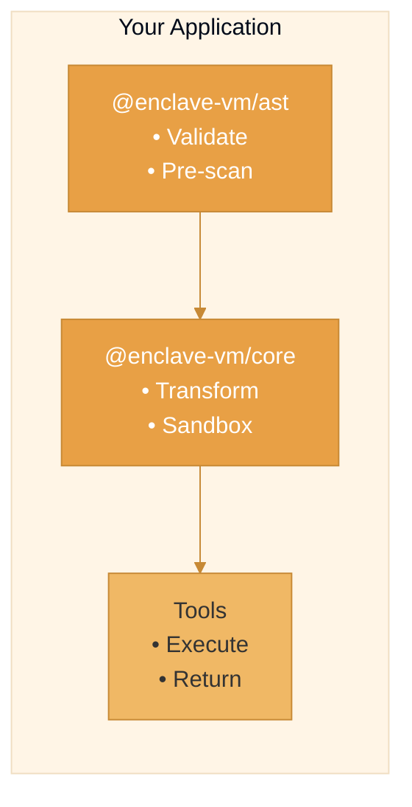
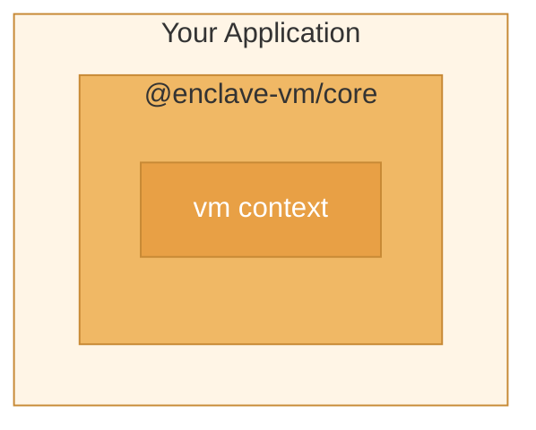
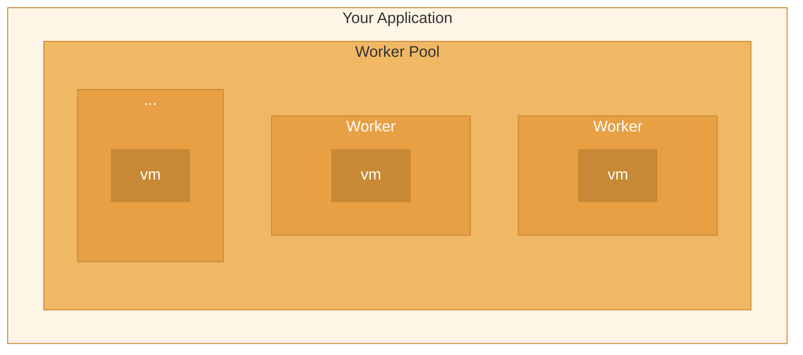
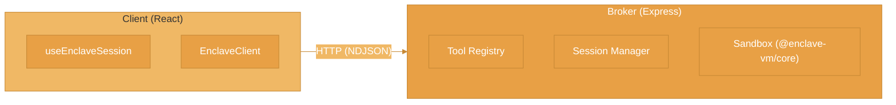
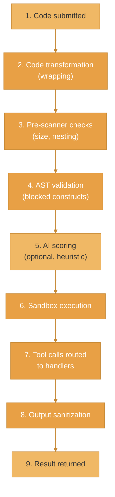
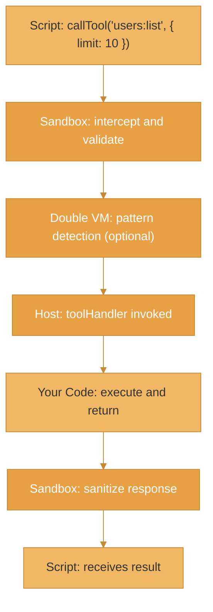

Enclave provides a layered security architecture for executing untrusted JavaScript code. This page explains the system components and how they work together.

## Core Components



### @enclave-vm/ast

Static analysis and validation layer:
- **Pre-scanner** - Checks size, nesting and literals before parsing
- **AST validation** - Blocks dangerous constructs
- **Code transformation** - Wraps code for safe execution

### @enclave-vm/core

Runtime execution layer:
- **Sandboxed context** - A realm that holds only the allowed globals, behind a membrane
- **Resource limits** - Timeout, iteration and tool-call limits, and memory accounting. In process the timeout and the memory limit are the enclave's own accounting; the worker pool adds the engine's heap limit and a hard stop
- **Tool routing** - Controlled external interactions

### Tools

Your application's capabilities exposed to scripts:
- **Your handlers** - Validate inputs and decide what a script may do; this is your code
- **Call limits** - `maxToolCalls` and the operation rate limit of the double VM bound how often tools are called
- **Audit logging** - Every tool call passes through your `toolHandler`, where you can log it

## Defense-in-Depth Layers

Enclave uses a 6-layer security model:

| Layer | Component | Purpose |
|-------|-----------|---------|
| 0 | Pre-Scanner | Bound the input before parsing |
| 1 | AST Validation | Block dangerous syntax |
| 2 | Code Transform | Wrap in safe runtime |
| 3 | AI Scoring Gate | Optional heuristic risk score |
| 4 | Runtime Sandbox | Isolate execution |
| 5 | Output Sanitization | Clean return values |

The layers are built to hold independently of each other: the runtime does not rely on the validator having refused a script. What the sandbox does not deliver is listed in the [Security Model](/concepts/security-model#what-enclave-does-not-protect-against).

## Deployment Architectures

### Single Process (Embedded)

Simplest deployment - everything runs in one process:



```ts
import { Enclave } from '@enclave-vm/core';

const enclave = new Enclave({
  toolHandler: async (name, args) => executeLocalTool(name, args),
});
```

**Best for:** Internal tools, low traffic, simplicity.

### Worker Pool (Worker Threads)

Code runs in the same sandbox, inside worker threads. A worker adds a heap limit that the engine enforces and a stop that does not depend on the script. A worker thread shares the process with your application: it is not process isolation.



```ts
import { Enclave } from '@enclave-vm/core';

const enclave = new Enclave({
  adapter: 'worker_threads',
  workerPoolConfig: {
    minWorkers: 2,
    maxWorkers: 8,
    memoryLimitPerWorker: 256 * 1024 * 1024,
  },
});
```

**Best for:** Untrusted code that must be stoppable, and a heap limit per worker as a backstop. For tenants that must not share a process, or a host that must survive whatever a script allocates, run one enclave per process or container.

### Client and Broker (EnclaveJS)

For applications with a browser client and streamed events:



- **Client** - `@enclave-vm/client` and the React hooks of `@enclave-vm/react`: send a script, follow the events
- **Broker** - `@enclave-vm/broker`: HTTP routes, tool registry, session management, and the sandbox, in one process

```ts
// Broker
import express from 'express';
import { createBroker, createSessionHandler, registerExpressRoutes } from '@enclave-vm/broker';
import type { SessionId } from '@enclave-vm/types';
import { z } from 'zod';

const broker = createBroker({ enclave: { securityLevel: 'SECURE' } });

broker.tool('users:list', {
  description: 'List users',
  argsSchema: z.object({ limit: z.number().optional() }),
  handler: async ({ limit }, context) => {
    // A handler is not handed the caller. It gets the id of its session, and the session
    // holds the caller that `identify` (below) returned for the request that created it.
    const caller = broker.getSession(context.sessionId as SessionId)?.owner;
    if (!caller) throw new Error('This session has no caller');
    return db.users.findAll({ visibleTo: caller, limit });
  },
});

const app = express();
app.use(express.json());
app.use(authenticate); // your authentication: the broker has none
registerExpressRoutes(
  app,
  createSessionHandler({
    broker,
    identify: (request) => (request.raw as { user?: { id: string } }).user?.id,
  }),
);
```

The broker does not authenticate callers, limit request rates or encrypt sessions, and the client does not encrypt either: use HTTPS, put your authentication in front of the routes, and give the routes an `identify` hook so that a session belongs to the caller that created it.

The hook separates sessions, not data. Every caller that may create a session can run a script that calls any registered tool, and a tool handler receives the arguments and a context (`sessionId`, `callId`, `secrets`, `signal`), not the caller. A tool that reads data restricted per caller has to apply that restriction itself, as `users:list` does above with the owner of its session, or the data store has to enforce it. A session created in process has no owner unless it is created with `owner`.

A third tier, in which the broker hands execution to a separate runtime worker, is not implemented: the broker has no option for it, and `@enclave-vm/runtime` does not execute scripts yet. To scale out, run several brokers (a session lives in the broker that created it, so a reconnect has to reach the same one).

**Best for:** Real-time UIs with tool calls on the server.

## Data Flow

### Request Flow



### Tool Call Flow



## When to Use Each Architecture

| Scenario | Recommended Architecture |
|----------|--------------------------|
| Prototyping | Single Process |
| Internal tools | Single Process |
| User scripts (single tenant) | Worker Pool |
| Multi-tenant SaaS | One enclave (or broker) per process or container for tenants that must not share a process |
| Real-time UI with streaming | Client and Broker |

## Related

- [Security Model](/concepts/security-model) - 6-layer defense explained
- [AgentScript](/concepts/agentscript) - Language subset definition
- [enclave-vm](/core-libraries/enclave-vm/overview) - Core library documentation
- [EnclaveJS](/enclavejs/overview) - Streaming runtime
