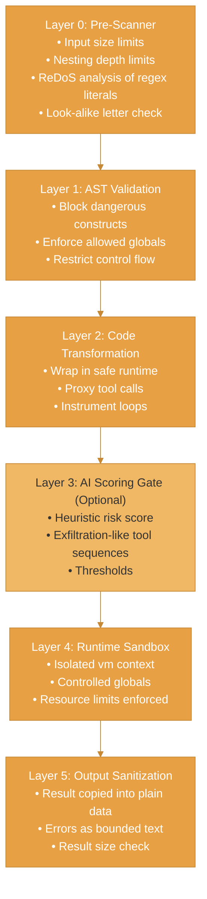

Enclave uses a defense-in-depth approach with 6 independent security layers. Each layer provides protection even if other layers are bypassed.

## The 6 Layers



## Layer 0: Pre-Scanner

Runs before the validator parses the script, so that the parser is not handed input it cannot cope with. `Enclave` runs the pre-scanner with its `standard` preset, whatever the AST preset:

| Check | Limit in the enclave | Purpose |
|-------|----------------------|---------|
| Input size | 5MB | Memory exhaustion |
| Lines | 10,000 lines of at most 10,000 chars | Minified code bombs |
| Nesting depth | 50 levels | Stack overflow |
| String literals | 500KB each, 5MB in total | Embedded data attacks |
| Regex literals | 30 of at most 500 chars, analyzed for ReDoS | ReDoS prevention |

The `standard` preset also refuses a null byte and a fixed list of look-alike letters (Cyrillic, Greek and full-width forms of letters such as `a`, `e` and `o`), anywhere in the script. It does not refuse bidirectional control characters (the characters of Trojan Source, CVE-2021-42574) or invisible characters. Those checks are part of the stricter [pre-scanner presets](/core-libraries/ast-guard/pre-scanner) of `@enclave-vm/ast`, which a host can run on a script itself before it calls `run()`.

A script is also limited to 5,242,880 characters, checked before anything parses it.

## Layer 1: AST Validation

Static analysis of the parsed AST to block dangerous patterns:

### Blocked Categories

| Category | Examples | Risk |
|----------|----------|------|
| Code execution | `eval`, `Function`, `setTimeout(string)` | Arbitrary code injection |
| System access | `process`, `require`, `import` | Host system access |
| Globals | `window`, `global`, `globalThis` | Sandbox escape |
| Prototype | `__proto__`, `constructor` | Prototype pollution |
| Metaprogramming | `Proxy`, `Reflect` | Interception |
| User functions | `function foo(){}` | Recursion bombs |

### Enforcement

```ts
// These are blocked by AST validation:
eval('malicious');           // ❌ eval blocked
new Function('return 1')();  // ❌ Function constructor blocked
process.exit();              // ❌ process access blocked
obj.__proto__.pollute = 1;   // ❌ prototype access blocked
```

## Layer 2: Code Transformation

Valid code is transformed for safe execution:

```ts
// Original code:
const users = await callTool('users:list', {});
for (const user of users) {
  console.log(user.name);
}

// Transformed code:
async function __ag_main() {
  const users = await __safe_callTool('users:list', {});
  for (const user of __safe_forOf(users)) {
    __safe_console.log(user.name);
  }
}
```

Transformations include:
- **Main wrapper** - Entry point for execution
- **Safe callTool** - Proxied through host with counting
- **Safe loops** - Iteration limits enforced
- **Safe console** - Rate-limited with output capture

## Layer 3: AI Scoring Gate

An optional heuristic: it scores a script by its tool calls (names, argument names, literal values, order, loops) and refuses it at a threshold. It flags patterns that look risky; a low score does not show that a script is safe.

| Pattern | Score | Example |
|---------|-------|---------|
| Data exfiltration | 50 | list → send sequence |
| Sensitive field access | 35 | Query for passwords/tokens |
| Excessive limits | 25 | `limit: 1000000` |
| Loop tool calls | 25 | `callTool` inside for loop |
| Dynamic tool names | 20 | Variable as tool name |

```ts
const enclave = new Enclave({
  scoringGate: {
    scorer: 'rule-based',
    blockThreshold: 70,
    warnThreshold: 40,
  },
});
```

## Layer 4: Runtime Sandbox

Code executes in an isolated Node.js vm context:

- **Fresh context** - No access to host scope
- **Controlled globals** - Only whitelisted APIs available
- **Resource limits** - Timeout, memory accounting, iterations, tool calls
- **Optional worker pool** - A heap limit per worker thread and a stop that does not depend on the script

### What's Available in the Sandbox

```ts
// Available in sandbox:
Math.random()               // ✓ Safe math
JSON.parse('{"a":1}')       // ✓ JSON handling
[1,2,3].map(x => x * 2)     // ✓ Array methods
await callTool('api', {})   // ✓ Tool calls (proxied)
console.log('debug')        // ✓ Console, with a consoleHandler or at PERMISSIVE (rate-limited)

// NOT available:
process.env.SECRET          // ✗ No process access
require('fs')               // ✗ No require
fetch('http://evil.com')    // ✗ No network
```

## Layer 5: Output Sanitization

Results are sanitized before returning to the caller:

- **Plain data** - The returned value is copied into plain host data; functions, symbols and prototype keys are dropped
- **Size check** - A value larger than the memory limit allows is refused
- **Errors as text** - `result.error` holds a `name` and a `message` of bounded length. An error made inside the sandbox has no stack; for the errors that have one, `sanitizeStackTraces` removes paths and frames

## Security Level Presets

Enclave provides preset configurations:

| Level | Timeout | Iterations | Tool Calls | Use Case |
|-------|---------|------------|------------|----------|
| STRICT | 5s | 1K | 10 | Untrusted code |
| SECURE | 15s | 5K | 50 | Semi-trusted |
| STANDARD | 30s | 10K | 100 | Internal tools |
| PERMISSIVE | 60s | 100K | 1K | Testing |

## What Enclave Protects Against

- **Code injection** - Blocked by AST validation
- **Infinite loops** - Limited by maxIterations
- **Resource exhaustion** - Limited by the timeout, the memory accounting and the other limits (see below for what they cover)
- **Prototype pollution** - Blocked by AST validation and by the runtime
- **Sandbox escape** - Blocked by controlled globals
- **Information leakage** - Errors made in the sandbox carry no stack; host stacks can be sanitized
- **ReDoS attacks** - AgentScript has no regular expressions, and with the default preset the script's realm cannot run one

## What Enclave Does NOT Protect Against

- **Tool abuse** - Scripts can call allowed tools; limit what's available
- **Algorithmic complexity** - O(n²) algorithms run within limits
- **Business logic attacks** - Tool-level validation required
- **Side effects** - Tool calls have real effects
- **A hard time or memory bound in process** - In process, the timeout and `memoryLimit` are the enclave's own accounting, not the engine's. The deadline is checked between the steps of the script's own code, so one call into a built-in is bounded by the size of what it works on, not by `timeout`; `memoryLimit` counts the operations that make text and arrays grow, not copies, objects, Maps or Sets. For the engine's own bounds, use the [worker pool](/core-libraries/enclave-vm/worker-pool), or a child process or container with limits of the operating system
- **A host process that survives whatever a worker allocates** - A worker thread shares the process; its heap limit is a backstop, not a guarantee
- **Misleading text in a script** - With the enclave's pre-scanner preset, bidirectional control characters and invisible characters in a script are not refused

## Best Practices

1. **Use STRICT for untrusted code** - AI-generated, user-submitted
2. **Limit available tools** - Only expose what's needed
3. **Validate tool inputs** - Check arguments before execution
4. **Monitor execution** - Log tool calls and durations
5. **Set appropriate limits** - Tune for your use case
6. **Keep updated** - Security improvements in new versions

## Related

- [Architecture](/concepts/architecture) - System overview
- [AgentScript](/concepts/agentscript) - Language definition
- [Security Levels](/core-libraries/enclave-vm/security-levels) - Preset details
