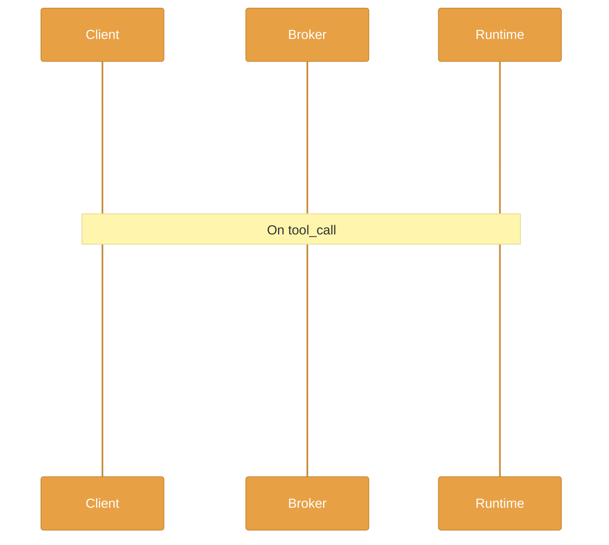
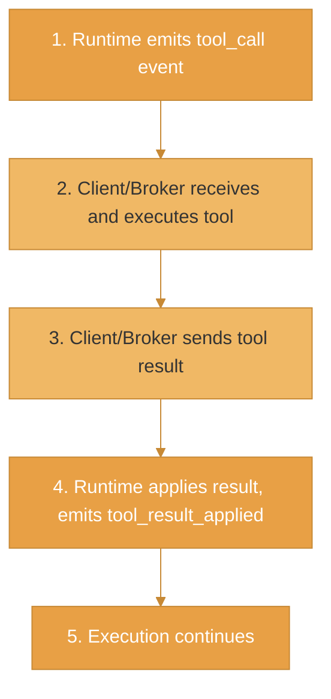

The EnclaveJS streaming protocol enables real-time communication between clients and the execution runtime. It uses NDJSON (Newline Delimited JSON) for efficient streaming. Events travel as plain JSON, protected by the transport.

## Protocol Overview



## Event Types

### session_init

Sent when a session starts:

```json
{
  "type": "session_init",
  "sessionId": "sess_abc123",
  "timestamp": 1704067200000,
  "payload": {
    "limits": {
      "maxDurationMs": 30000,
      "maxToolCalls": 100
    }
  }
}
```

### stdout

Captured console output:

```json
{
  "type": "stdout",
  "sessionId": "sess_abc123",
  "timestamp": 1704067200100,
  "payload": {
    "data": "Processing user: Alice\n"
  }
}
```

### log

Structured log messages:

```json
{
  "type": "log",
  "sessionId": "sess_abc123",
  "timestamp": 1704067200150,
  "payload": {
    "level": "info",
    "message": "Tool call completed",
    "data": { "tool": "users:list", "duration": 42 }
  }
}
```

### tool_call

Request for tool execution:

```json
{
  "type": "tool_call",
  "sessionId": "sess_abc123",
  "timestamp": 1704067200200,
  "payload": {
    "callId": "call_xyz789",
    "tool": "users:list",
    "args": { "limit": 10 }
  }
}
```

### tool_result_applied

Confirmation that tool result was applied:

```json
{
  "type": "tool_result_applied",
  "sessionId": "sess_abc123",
  "timestamp": 1704067200300,
  "payload": {
    "callId": "call_xyz789"
  }
}
```

### heartbeat

Keep-alive message:

```json
{
  "type": "heartbeat",
  "sessionId": "sess_abc123",
  "timestamp": 1704067205000,
  "payload": {}
}
```

### final

Session completed:

```json
{
  "type": "final",
  "sessionId": "sess_abc123",
  "timestamp": 1704067210000,
  "payload": {
    "result": { "count": 5, "items": [...] },
    "stats": {
      "duration": 10000,
      "toolCallCount": 3,
      "iterationCount": 15
    }
  }
}
```

### error

Execution error:

```json
{
  "type": "error",
  "sessionId": "sess_abc123",
  "timestamp": 1704067210000,
  "payload": {
    "code": "TIMEOUT",
    "message": "Execution exceeded 30s timeout"
  }
}
```

## NDJSON Format

Events are sent as newline-delimited JSON:

```
{"type":"session_init","sessionId":"sess_abc123",...}\n
{"type":"stdout","sessionId":"sess_abc123",...}\n
{"type":"tool_call","sessionId":"sess_abc123",...}\n
{"type":"final","sessionId":"sess_abc123",...}\n
```

Benefits:
- **Streaming-friendly** - Parse events as they arrive
- **Memory efficient** - No buffering entire response
- **Simple parsing** - Split by newline, parse each line

## Tool Call Flow

When the runtime needs to call a tool:



### Submitting Tool Results

```ts
// Via HTTP (when using broker)
POST /sessions/:sessionId/tool-result
{
  "callId": "call_xyz789",
  "result": { "users": [...] }
}

// Via WebSocket (direct to runtime)
{
  "type": "tool_result",
  "callId": "call_xyz789",
  "result": { "users": [...] }
}
```

## Encryption

The first-party client and broker do not encrypt. `@enclave-vm/client`, `@enclave-vm/react`, `@enclave-vm/broker` and `@enclave-vm/runtime` perform no handshake and have no encryption option: a session is plain NDJSON protected only by the transport, so use HTTPS.

The protocol types in `@enclave-vm/types` define hello messages and an encrypted envelope, and `@enclave-vm/stream` exports matching primitives (ECDH P-256, HKDF-SHA-256, AES-256-GCM). They are defined, but the first-party client and broker do not use them. An application that wants payload encryption on top of TLS has to implement both ends itself; see [Encrypted Sessions](/examples/encrypted-sessions).

### Hello Messages

`ClientHello` and `ServerHello` carry the ephemeral public keys of an ECDH key exchange:

```json
{
  "protocolVersion": 2,
  "clientEphemeralPubKeyB64": "base64-public-key",
  "curve": "P-256",
  "supportedAlgorithms": ["AES-GCM-256"]
}
```

```json
{
  "protocolVersion": 2,
  "serverEphemeralPubKeyB64": "base64-public-key",
  "curve": "P-256",
  "selectedAlgorithm": "AES-GCM-256",
  "kdf": "HKDF-SHA-256",
  "keyId": "k_..."
}
```

The exchange is not authenticated. `ServerHello` has a reserved `signatureB64` field, but nothing creates or verifies it. The exchange protects against a party that can only read the connection, not against one that can change messages.

### Encrypted Envelope

An event of type `enc` wraps another event:

```json
{
  "protocolVersion": 2,
  "sessionId": "s_abc123",
  "seq": 42,
  "type": "enc",
  "payload": {
    "kid": "k_...",
    "nonceB64": "base64-nonce",
    "ciphertextB64": "base64-ciphertext-with-auth-tag"
  }
}
```

The stream primitives authenticate the header of the envelope (protocol version, session id, sequence number, key id) together with the event inside it. `@enclave-vm/client` does not decrypt `enc` events: a session that receives one fails with `PARSE_ERROR`.

## Reconnection

The client reconnects to a session when its connection is lost, and the broker replays the events the client has not seen:

```ts
import { EnclaveClient } from '@enclave-vm/client';

const client = new EnclaveClient({
  baseUrl: 'https://broker.example.com',
  autoReconnect: true, // default
  maxReconnectAttempts: 3, // default
  reconnectDelay: 1000, // milliseconds, default
});
```

### Sequence Tracking

Events include sequence numbers for ordering:

```json
{
  "type": "stdout",
  "seq": 42,
  ...
}
```

On reconnection, the client asks the broker for the events after the last one it received: `GET /sessions/:sessionId/stream?fromSeq=N`, where `N` is the next sequence number the client expects.

## Event Filtering

Filter events to reduce bandwidth:

```ts
// Only receive specific event types
const stream = broker.execute(code, {
  filter: {
    types: ['stdout', 'final', 'error'],
  },
});

// Block noisy events
const stream = broker.execute(code, {
  filter: {
    blockedTypes: ['heartbeat', 'log'],
  },
});
```

## Protocol Constants

| Constant | Value | Description |
|----------|-------|-------------|
| `PROTOCOL_VERSION` | `"1.0"` | Protocol version |
| `HEARTBEAT_INTERVAL` | 5000ms | Time between heartbeats |
| `DEFAULT_TIMEOUT` | 30000ms | Default session timeout |

## Related

- [EnclaveJS Overview](/enclavejs/overview) - Streaming runtime architecture
- [@enclave-vm/types](/enclavejs/types) - Type definitions
- [@enclave-vm/stream](/enclavejs/stream) - Stream utilities
