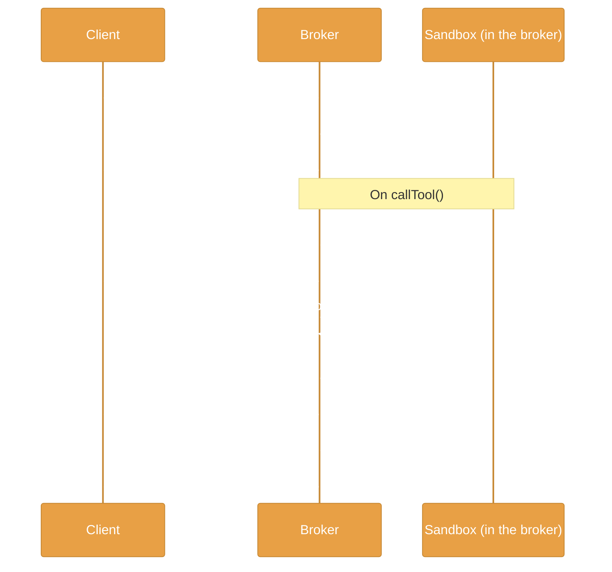
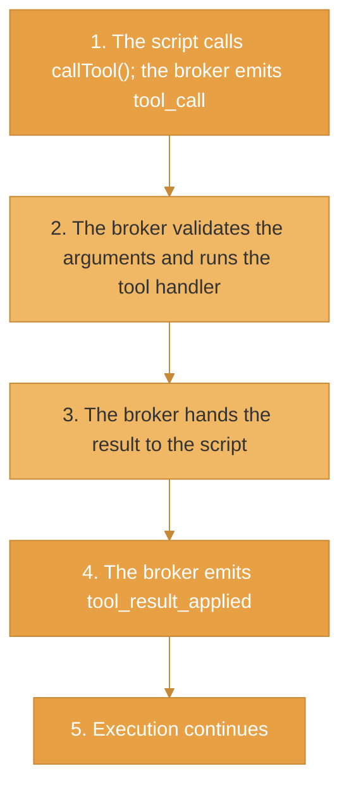

The EnclaveJS streaming protocol enables real-time communication between clients and the execution runtime. It uses NDJSON (Newline Delimited JSON) for efficient streaming. Events travel as plain JSON, protected by the transport.

## Protocol Overview



The broker runs the script in an `@enclave-vm/core` sandbox in its own process, and it runs the tools itself. The client is told about tool calls; it does not execute them and submits no results.

## Event Structure

Every event has the same envelope:

| Field | Description |
|-------|-------------|
| `protocolVersion` | `2` (events of version `1` are still accepted by the schemas) |
| `sessionId` | The session id, `s_` followed by the id |
| `seq` | Sequence number of the event within its session, starting at 1 |
| `type` | The event type |
| `payload` | Type-specific data |

There is no timestamp field.

## Event Types

### session_init

The first event of a session:

```json
{
  "protocolVersion": 2,
  "sessionId": "s_abc123",
  "seq": 1,
  "type": "session_init",
  "payload": {
    "cancelUrl": "/sessions/s_abc123/cancel",
    "expiresAt": "2026-01-01T00:01:00.000Z",
    "encryption": { "enabled": false }
  }
}
```

### tool_call

The script called a tool. The broker runs it:

```json
{
  "protocolVersion": 2,
  "sessionId": "s_abc123",
  "seq": 2,
  "type": "tool_call",
  "payload": {
    "callId": "c_xyz789",
    "toolName": "users:list",
    "args": { "limit": 10 }
  }
}
```

### tool_result_applied

The result of a tool call was handed to the script. The result itself is not part of the event:

```json
{
  "protocolVersion": 2,
  "sessionId": "s_abc123",
  "seq": 3,
  "type": "tool_result_applied",
  "payload": {
    "callId": "c_xyz789"
  }
}
```

### heartbeat

Keep-alive message, sent every `heartbeatIntervalMs` (15 seconds by default):

```json
{
  "protocolVersion": 2,
  "sessionId": "s_abc123",
  "seq": 4,
  "type": "heartbeat",
  "payload": { "ts": "2026-01-01T00:00:15.000Z" }
}
```

### final

The last event of a session. A session that succeeded:

```json
{
  "protocolVersion": 2,
  "sessionId": "s_abc123",
  "seq": 5,
  "type": "final",
  "payload": {
    "ok": true,
    "result": { "count": 5 },
    "stats": {
      "durationMs": 10000,
      "toolCallCount": 3,
      "stdoutBytes": 0
    }
  }
}
```

A session that failed or was cancelled has `"ok": false` and an `error` with a `message` and a `code` in place of `result`.

### error

An error that is reported besides the `final` event. The broker emits one when a session is cancelled while no script is executing:

```json
{
  "protocolVersion": 2,
  "sessionId": "s_abc123",
  "seq": 5,
  "type": "error",
  "payload": {
    "code": "SESSION_CANCELLED",
    "message": "Session was cancelled",
    "recoverable": false
  }
}
```

### stdout and log

The protocol defines `stdout` (`payload: { chunk }`) and `log` (`payload: { level, message, data? }`) events, and the client has handlers for them. The broker does not emit them.

### Events of protocol version 2

| Type | Payload | Description |
|------|---------|-------------|
| `tool_progress` | `callId`, `phase`, `elapsedMs`, `bytesReceived?`, `totalBytes?` | Progress of a tool call |
| `partial_result` | `path`, `data?`, `error?`, `hasNext` | Part of a result |
| `deadline_exceeded` | `elapsedMs`, `budgetMs` | The deadline of the session passed |
| `catalog_changed` | `version`, `addedActions`, `removedActions` | The tool catalog changed |

## NDJSON Format

Events are sent as newline-delimited JSON:

```
{"protocolVersion":2,"sessionId":"s_abc123","seq":1,"type":"session_init",...}\n
{"protocolVersion":2,"sessionId":"s_abc123","seq":2,"type":"tool_call",...}\n
{"protocolVersion":2,"sessionId":"s_abc123","seq":3,"type":"tool_result_applied",...}\n
{"protocolVersion":2,"sessionId":"s_abc123","seq":4,"type":"final",...}\n
```

Benefits:
- **Streaming-friendly** - Parse events as they arrive
- **Memory efficient** - No buffering entire response
- **Simple parsing** - Split by newline, parse each line

A parser should bound the length of a line: the parsers of `@enclave-vm/stream` and the client refuse an event of more than 8 MiB by default.

## Tool Call Flow

When a script calls a tool:



There is no route or message with which a client submits a tool result: tools are registered on the broker (`broker.tool(...)`) and run there.

## Encryption

The first-party client and broker do not encrypt. `@enclave-vm/client`, `@enclave-vm/react`, `@enclave-vm/broker` and `@enclave-vm/runtime` perform no handshake and have no encryption option: a session is plain NDJSON protected only by the transport, so use HTTPS.

The protocol types in `@enclave-vm/types` define hello messages and an encrypted envelope, and `@enclave-vm/stream` exports matching primitives (ECDH P-256, HKDF-SHA-256, AES-256-GCM). They are defined, but the first-party client and broker do not use them. An application that wants payload encryption on top of TLS has to implement both ends itself; see [Encrypted Sessions](/examples/encrypted-sessions).

### Hello Messages

`ClientHello` and `ServerHello` carry the ephemeral public keys of an ECDH key exchange:

```json
{
  "protocolVersion": 2,
  "clientEphemeralPubKeyB64": "base64-public-key",
  "curve": "P-256",
  "supportedAlgorithms": ["AES-GCM-256"]
}
```

```json
{
  "protocolVersion": 2,
  "serverEphemeralPubKeyB64": "base64-public-key",
  "curve": "P-256",
  "selectedAlgorithm": "AES-GCM-256",
  "kdf": "HKDF-SHA-256",
  "keyId": "k_..."
}
```

The exchange is not authenticated. `ServerHello` has a reserved `signatureB64` field, but nothing creates or verifies it. The exchange protects against a party that can only read the connection, not against one that can change messages.

### Encrypted Envelope

An event of type `enc` wraps another event:

```json
{
  "protocolVersion": 2,
  "sessionId": "s_abc123",
  "seq": 42,
  "type": "enc",
  "payload": {
    "kid": "k_...",
    "nonceB64": "base64-nonce",
    "ciphertextB64": "base64-ciphertext-with-auth-tag"
  }
}
```

The stream primitives authenticate the header of the envelope (protocol version, session id, sequence number, key id) together with the event inside it. `@enclave-vm/client` does not decrypt `enc` events: a session that receives one fails with `PARSE_ERROR`.

## Reconnection

The client reconnects to a session when its connection is lost, and the broker replays the events the client has not seen:

```ts
import { EnclaveClient } from '@enclave-vm/client';

const client = new EnclaveClient({
  baseUrl: 'https://broker.example.com',
  autoReconnect: true, // default
  maxReconnectAttempts: 3, // default
  reconnectDelay: 1000, // milliseconds, default
});
```

### Sequence Tracking

Events include sequence numbers for ordering:

```json
{
  "type": "stdout",
  "seq": 42,
  ...
}
```

On reconnection, the client asks the broker for the events after the last one it received: `GET /sessions/:sessionId/stream?fromSeq=N`, where `N` is the next sequence number the client expects.

## Event Filtering

A filter decides which events a client is sent. The body of `POST /sessions` may carry one (`EnclaveClient` has no option for it: send the request yourself, or filter on the server with `createEventFilter`):

```json
{
  "code": "return 1;",
  "filter": {
    "mode": "exclude",
    "rules": [{ "types": { "types": ["heartbeat", "tool_progress"] } }]
  }
}
```

`mode` is `include` (send only matching events) or `exclude` (do not send matching events). A rule can match by event type and by content. `session_init` and `final` are always sent. See [Event Filtering](/enclavejs/broker#event-filtering) for the patterns and the bounds on a filter.

A filter is a convenience for the client, not a confidentiality control.

## Protocol Constants

| Constant | Value | Description |
|----------|-------|-------------|
| `PROTOCOL_VERSION` | `2` | Protocol version |
| `PROTOCOL_VERSION_V1` | `1` | Previous version |
| `SESSION_ID_PREFIX` | `'s_'` | Prefix of session ids |
| `CALL_ID_PREFIX` | `'c_'` | Prefix of tool call ids |
| `DEFAULT_SESSION_LIMITS.heartbeatIntervalMs` | 15000 | Time between heartbeats |
| `DEFAULT_SESSION_LIMITS.sessionTtlMs` | 60000 | Default lifetime of a session |
| `DEFAULT_SESSION_LIMITS.toolTimeoutMs` | 30000 | Default run time of a script in the broker |

## Related

- [EnclaveJS Overview](/enclavejs/overview) - Streaming runtime architecture
- [@enclave-vm/types](/enclavejs/types) - Type definitions
- [@enclave-vm/stream](/enclavejs/stream) - Stream utilities
