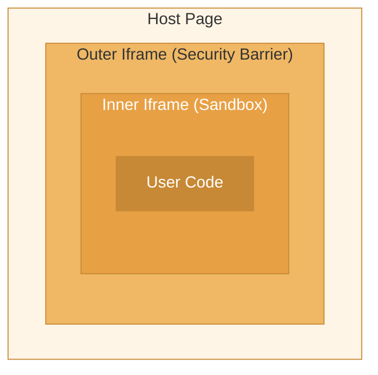
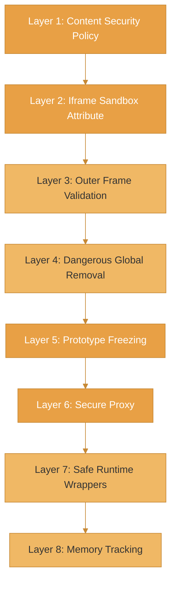
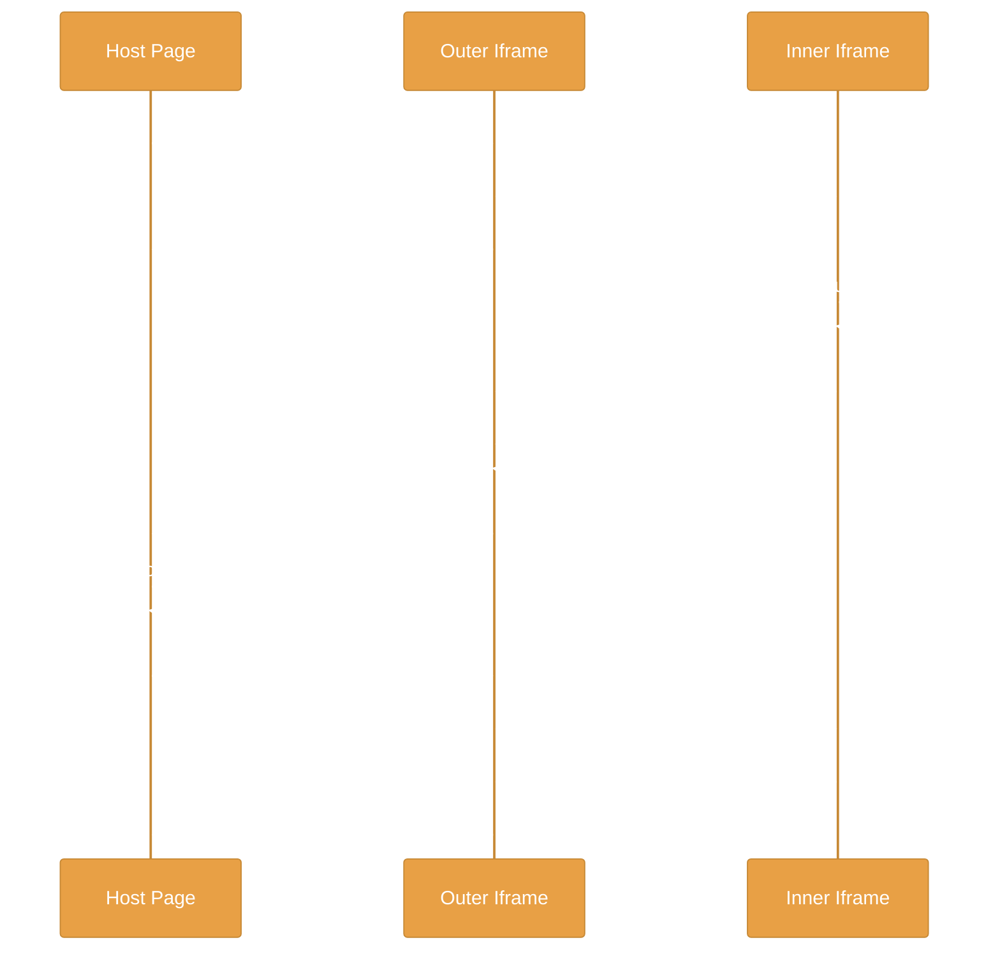

`@enclave-vm/browser` implements defense-in-depth through a double iframe architecture. Each execution creates two nested iframes — an outer security barrier and an inner sandbox — with 8 distinct security layers that work together to prevent sandbox escapes.

The layers do not all stand on their own. Some are enforced by the browser, some by the host page, and some hold only for a script the validator has accepted: [What Each Guarantee Rests On](#what-each-guarantee-rests-on) says which is which, and [Timeouts and the Browser's Process Model](#timeouts-and-the-browsers-process-model) says when a script that never yields can be stopped.

## Double Iframe Architecture



- **Host Page**: Your application. Creates the outer iframe and handles tool calls.
- **Outer Iframe**: Security barrier with rate limiting, pattern detection, and name filtering. Relays validated messages between host and inner iframe.
- **Inner Iframe**: The actual sandbox. Contains prototype hardening, secure proxies, safe runtime wrappers, and the user code.

## The 8 Security Layers



### Layer 1: Content Security Policy

Both iframe documents carry a strict CSP in a `<meta>` tag:

```
default-src 'none'; script-src 'sha256-…'; style-src 'unsafe-inline'
```

| Directive | Effect |
|-----------|--------|
| `default-src 'none'` | No request source the policy governs is allowed: `fetch`, XHR, WebSocket, WebTransport, EventSource, beacons, images, fonts, styles and media by URL, frames with a URL, workers |
| `script-src 'sha256-…'` | The only script that runs in the document is the one this package wrote into it, named by its SHA-256 hash. No other inline script, no event-handler attribute and no `javascript:` URL runs |
| No `'unsafe-eval'` | `eval()`, `new Function()` and `setTimeout(string)` are refused. Equivalent to Node.js VM `codeGeneration: { strings: false, wasm: false }` |

The outer document's policy names two scripts: its own and the inner document's. A document that a frame creates inherits the policy of its creator, so the inner document is bound by both policies, and every document the inner frame could create is bound to the inner document's one script. Nothing but the two scripts the package wrote runs in any document of the sandbox, and no worker starts.

The policy has no say over a peer connection (WebRTC). The names that create one are removed from the inner frame instead: see Layer 4.

### Layer 2: Iframe Sandbox Attribute

Both iframes use a restrictive sandbox attribute:

```
sandbox="allow-scripts"
```

Only `allow-scripts` is enabled. Crucially, `allow-same-origin` is **not** set, which means:
- The iframe cannot access the host page's DOM, cookies, or storage
- The iframe cannot read `parent.document` or `top.document`
- The iframe has a unique `null` origin

### Layer 3: Outer Frame Validation

The outer iframe acts as a security barrier between the host and the inner sandbox. All tool calls from the inner iframe pass through validation:

| Check | Description |
|-------|-------------|
| **Rate limiting** | Max operations per second (default: 100) |
| **Name validation** | Tool names must be non-empty strings of at most 256 characters |
| **Whitelist pattern** | Optional regex to allow only specific tool names |
| **Blacklist patterns** | Multiple regexes to block specific tool names |
| **Suspicious pattern detection** | Heuristics over tool names and arguments for multi-step sequences (exfiltration, credential theft, etc.), within the two seconds of calls the outer iframe records |
| **Rapid enumeration** | Detects the same operation being called repeatedly (default threshold: more than 30 within the two seconds of calls the outer iframe records) |

### Layer 4: Dangerous Global Removal

Dangerous globals are deleted from the inner iframe's `window` object based on the security level:

| Global | STRICT | SECURE | STANDARD | PERMISSIVE |
|--------|--------|--------|----------|------------|
| `Function`, `eval` | Removed | Removed | Removed | Available |
| `globalThis` | Removed | Removed | Available | Available |
| `Proxy` | Removed | Removed | Available | Available |
| `Reflect` | Removed | Available | Available | Available |
| `SharedArrayBuffer`, `Atomics` | Removed | Removed | Removed | Removed |
| `WebAssembly` | Removed | Removed | Removed | Removed |
| `WeakRef`, `FinalizationRegistry` | Removed | Removed | Removed | Available |
| `ShadowRealm` | Removed | Removed | Removed | Removed |
| `Iterator`, `AsyncIterator` | Removed | Removed | Available | Available |
| `performance`, `Temporal` | Removed | Available | Available | Available |

**Always removed** (all security levels):
`fetch`, `XMLHttpRequest`, `WebSocket`, `EventSource`, `Worker`, `SharedWorker`, `ServiceWorker`, `importScripts`, `localStorage`, `sessionStorage`, `indexedDB`, `caches`, `navigator` (also under its other name, `clientInformation`), `open`, `close`, `alert`, `confirm`, `prompt`, and the peer-connection constructors (`RTCPeerConnection` and its prefixed aliases).

The peer-connection constructors open a connection that the document policy does not govern. They are removed at every security level and for every preset, the object behind the name is made unusable as well (its members throw `TypeError: Network connections are not available in this sandbox`, and it is frozen), and a run whose frame still has one of the names is not started (`SANDBOX_SETUP_FAILED`).

**The frame's document is closed.** A node that is part of a document can make the browser load something, and not every such load is a request the document policy governs. A script has no use for the document of the frame it runs in (the frame is never shown), so before a script starts the inner frame's document is emptied, and every member of the prototypes a document gets its behaviour from, and of `Range`, throws `TypeError: The document of this sandbox frame is not available`. With no node in the document and no way to add one, nothing a script builds is ever part of a document: no element loads anything, and no frame is created. This holds at every security level and for every preset.

What cannot be removed: a page's `window`, `document`, `location` and `top` are properties the browser does not let a script delete or replace. The name `document` is shadowed in the scope a script runs in, and the validator refuses all four names and every other name it does not know, so a validated script cannot reach them. This layer removes names and closes the document; it is the validator that keeps a script from naming the window the names were removed from.

### Layer 5: Prototype Freezing

All built-in prototypes are frozen after security patches are applied:

- `Object.prototype`, `Array.prototype`, `Function.prototype`
- `String.prototype`, `Number.prototype`, `Boolean.prototype`
- `Date.prototype`, `Error.prototype`, `Promise.prototype`
- `TypeError.prototype`, `RangeError.prototype`, `SyntaxError.prototype`
- `ReferenceError.prototype`, `URIError.prototype`, `EvalError.prototype`

Legacy accessor methods (`__lookupGetter__`, `__lookupSetter__`, `__defineGetter__`, `__defineSetter__`) are replaced with no-ops on `Object.prototype`. Error prototypes have `__proto__` shadowed to return `null`.

#### Regular expressions

AgentScript has no regular expressions: the validator refuses a literal, the `RegExp` name and the methods that run a pattern. When a script is validated with the `agentscript` preset (the default), its realm cannot run one either:

- `exec`, `test`, `compile` and the `Symbol.match` / `matchAll` / `replace` / `search` / `split` methods of `RegExp.prototype` throw `TypeError: Regular expressions are not available in this sandbox`, and the prototype is frozen. Every regular expression of the realm reaches its matcher through these, including the one the engine builds from a string for `match`, `matchAll` and `search`.
- The names `RegExp` and `URLPattern` are removed from the realm.

String methods that take a plain string (`split(',')`, `replace('a', 'b')`, `includes`, `indexOf`) are not affected. With another preset, or with `validate: false`, regular expressions work as in any page. `@enclave-vm/core` applies the same rule with its realm allowlist.

### Layer 6: Secure Proxy

Every global object exposed to user code is wrapped in a `Proxy` that blocks access to dangerous properties:

| Blocked Property | Purpose |
|-----------------|---------|
| `__proto__` | Prevents prototype chain manipulation |
| `prototype` | Prevents constructor prototype access |
| `constructor` | Prevents access to native constructors |
| `__defineGetter__` | Prevents legacy accessor injection |
| `__defineSetter__` | Prevents legacy accessor injection |
| `__lookupGetter__` | Prevents legacy accessor introspection |
| `__lookupSetter__` | Prevents legacy accessor introspection |

The proxy behavior is configurable per security level. At `STRICT` and `SECURE` levels, accessing blocked properties throws an error. At `PERMISSIVE`, it returns `undefined`.

Custom `globals` are serialized into the inner frame's bootstrap, so sandboxed code only ever sees plain data for them — no live outer-page object crosses the frame boundary.

Additionally, dangerous static methods on `Object` are neutralized: `defineProperty`, `defineProperties`, `setPrototypeOf`, `getOwnPropertyDescriptor`, and `getOwnPropertyDescriptors`.

### Layer 7: Safe Runtime Wrappers

User code runs through transformed wrappers that enforce resource limits:

| Wrapper | Purpose |
|---------|---------|
| `callTool(name, args)` | Tool calls with count limits and JSON sanitization. A name longer than 256 characters, or arguments that are not an object or are nested more than 100 levels deep, are refused with an ordinary error |
| Loop counters | Every `for`, `while` and `do…while` loop gets a counter of its own, compared with `maxIterations` on each pass |
| `__safe_forOf` | For-of loops with the same limit (generator-based) |
| `parallel(fns)` | Parallel execution of up to 100 total operations with configurable concurrency (default 10, max 20) |
| `console` | Console relay with call count and byte limits |

The iteration limit is per loop: each loop may run `maxIterations` passes every time it is entered, so nested loops multiply, and the callbacks a built-in drives (`map`, `forEach`, `sort`) are not counted. It stops a loop that does not end; it is not a bound on the work a script does. That bound is the timeout: see [Timeouts and the Browser's Process Model](#timeouts-and-the-browsers-process-model).

This is the AgentScript transform alone. `@enclave-vm/core` applies three more steps after validation that the browser does not: the guard on property keys known only at run time, the deadline checks inside functions and loops, and the tracking of string concatenation. The frame also defines `__safe_concat` and `__safe_template` for code transformed elsewhere; the browser's own transform does not emit them.

### Layer 8: Memory Tracking

Memory-intensive operations are patched to track estimated usage:

| Method | Protection |
|--------|-----------|
| `String.prototype.repeat` | Estimates `length * count * 2` bytes before execution |
| `String.prototype.padStart`, `padEnd` | Estimates the padded length times 2 bytes before execution |
| `Array.prototype.join` | Estimates total string output before execution |
| `Array.prototype.fill` | Estimates `fillCount * 8` bytes before execution |

When the cumulative tracked memory exceeds `memoryLimit` (default: 1MB), a `RangeError` is thrown. An estimate that is not a positive number counts as nothing, so a call with a missing, non-numeric or negative size neither switches the accounting off nor gives back what was charged before; and when a call builds more than was estimated, the difference is charged afterwards.

<Warning>
  Memory tracking in the browser is **estimation-based**, and it covers the methods in the table only. String concatenation, spreads, array literals and `Array.from` are not counted: a script can still build a large value step by step. It is a defense against the memory bombs that take one call, not a memory budget.
</Warning>

## Message Protocol

All communication between layers uses `postMessage` with validated messages. Every message includes a `__enclave_msg__: true` discriminator and a `requestId` for correlation.



### Message Types

| Direction | Type | Description |
|-----------|------|-------------|
| Inner/Outer to Host | `tool-call` | Tool invocation with `toolName`, `args`, `callId` |
| Host to Inner/Outer | `tool-response` | Tool result or error with `callId` |
| Inner to Host | `result` | Execution result with `success`, `value`/`error`, `stats` |
| Inner to Host | `console` | Console output with `level` and `args` |
| Outer to Host | `ready` | Outer iframe initialized |
| Host to Inner | `abort` | Signal to abort execution |

### What the Host Checks

The host page does not take the iframes' word for anything. It listens only to the outer iframe of the execution it started, and every message from it is validated against a Zod schema before it is acted on. A message that does not match (an unknown type, a missing or extra field, a tool name that is not a string of 1–256 characters, arguments that are not an object, the id of another execution) ends the execution with `PROTOCOL_VIOLATION` and removes the iframes.

The limits that protect the host are enforced by the host as well as inside the sandbox:

- **Tool calls**: no more than `maxToolCalls` reach your tool handler, and a tool name that `allowedOperationPattern` or `blockedOperationPatterns` refuse does not reach it. The function-based `suspiciousPatterns` of your configuration are asked here as well, for every call that got this far.
- **Tool arguments**: the handler receives a copy made by the host, of JSON data only (strings, finite numbers, booleans, `null`, arrays without holes and plain objects), without `__proto__`, `constructor` or `prototype` keys at any depth. Arguments that hold anything else end the execution. A call whose arguments hold more than 1,000,000 array items and object keys is refused (the script's `callTool` rejects) and the handler is not called.
- **Results**: a returned value is copied into plain host data (primitives, arrays, dates and plain objects, within `maxSanitizeDepth` and `maxSanitizeProperties`); anything else ends the execution. Error texts are cut to a bounded length.
- **Console**: no more than `maxConsoleCalls` lines and `maxConsoleOutputBytes` reach the host console. The host copies each line, counts it by the JSON text of that copy, and prints the copy. A line that holds anything but plain data (strings, numbers, booleans, `null`, `undefined`, arrays and plain objects, at most 100 levels deep) is dropped and still counts as a call. The sandbox sends objects as their JSON copy and a BigInt, symbol or function as its text.

A validated script cannot produce `PROTOCOL_VIOLATION` by itself. What the host would refuse as a broken protocol (a tool name that is too long, arguments that are too deep or are not an object, a result beyond its limits) the inner iframe refuses first, as an ordinary error the script can catch.

## What Each Guarantee Rests On

The inner iframe is a document, and a script is part of the same piece of code as the logic that sets the sandbox up. Four different things keep a script in place (the browser, what the inner frame does before a script starts, the host page, and the validator), and it matters which one a property depends on:

| Property | Enforced by | Holds with `validate: false` |
|----------|-------------|------------------------------|
| The host page's DOM, cookies and storage cannot be reached | The browser: `sandbox="allow-scripts"` without `allow-same-origin` | Yes |
| No request through any source the document policy governs (Layer 1) | The browser: `default-src 'none'` | Yes |
| No peer connection | The inner frame: the constructors are removed before the script starts (Layer 4), and no other document of the sandbox can run a script that would bring them back | Yes, as measured in Chromium |
| No load started by an element, and no child frame | The inner frame: its document is empty and closed before the script starts (Layer 4) | Yes, as measured in Chromium |
| No code from a string, no script in another document, no worker | The browser: `script-src` names two scripts by hash | Yes |
| Tool-call limit, tool names, the copy of tool arguments and of results, console limits | The host page (above) | Yes |
| A script cannot name `window`, `document`, `location`, a variable of the sandbox's own code, or any other property of the frame's window | The validator: unknown names are refused | **No** |
| Removed globals, frozen prototypes, secure proxies, memory tracking, loop limits (Layers 4 to 8) | The inner frame, for a script the validator has confined to the names it allows | **No**: a script that reaches the frame's `window` reaches what the browser leaves there, and the sandbox's own variables |
| A script that never yields ends at the timeout | The browser's process model (below) | Same in both cases |

With `validate: false` (or a preset other than `agentscript` together with `transform: false`) a script has the inner frame's window to itself: it can read and change the variables of the sandbox's own code, including the limits and counters kept there, it can post messages as the frame, and it can learn the origin of the page that embeds the sandbox. What still holds is what the browser, the closed frame and the host page enforce, the first six rows. Run code you do not trust with validation on.

The network rows were measured in Chromium 145, in the headless shell and in the full build, with a listener on the local machine for each kind of request. Firefox and Safari have not been measured.

Custom globals and tool namespaces reach a script as parameters of the function it runs in, so a configured name means the host's value even when the frame's window or the sandbox's own code has something of the same name.

## Timeouts and the Browser's Process Model

The timeout is kept by timers: one in the outer iframe for the script's own running time, and two in the host page (the hard stop at `timeout` plus `parentTimeoutBuffer`, and the bound on a tool call that is in progress then). A timer fires between tasks, and the two frames share one thread. A script that computes without yielding (a long loop, a chain of callbacks) holds that thread, and the outer iframe's timer cannot fire until it yields.

What ends such a script is the host page's hard stop, which removes the frames. That works where the browser runs the sandboxed frames in a different process from the page:

| Where the frames run | A script that never yields |
|----------------------|----------------------------|
| In another process than the page (Chromium 145 on a desktop with its default settings) | Ended by the host page at `timeout` plus `parentTimeoutBuffer`. The page stays responsive |
| In the page's process (the Chromium headless shell with its default settings; any browser or embedded web view that keeps a sandboxed `srcdoc` frame in the page's process) | Not ended. It holds the page's thread as well: the page does not respond, no timer of the host fires, and `run()` returns the timeout error only when the script has finished |

Firefox and Safari have not been measured. There is nothing a page can do to interrupt a script that shares its thread, so where that is the case the timeout bounds a script that waits (for a tool, for a promise) and not one that computes. The per-loop iteration limit narrows what a script can do in one loop; it does not bound nested loops or callbacks. `@enclave-vm/core`, on a server, checks the deadline inside the script's own loops and functions and does not depend on a timer for this.

With the default `toolCallGraceMs`, `run()` returns within about three times `timeout` plus `parentTimeoutBuffer` where the timers can fire: tool calls may be in progress for `timeout`, the buffer and the grace, and the script's own running time is bounded by `timeout` on top of that.

## What's Blocked

| Attack Vector | Protection |
|---------------|-----------|
| Network requests | CSP `default-src 'none'` for every request source it governs (fetch, XHR, WebSocket, WebTransport, EventSource, beacons, subresources); the peer-connection constructors are removed from the inner frame, and its document is closed, so no element starts a load |
| `eval` / `new Function` | CSP blocks all forms of code generation from strings |
| Script in another document or a worker | CSP: only the two scripts the package wrote run, in any document the frames create |
| DOM access | The inner frame's document is empty and closed, and the validator refuses `document` and `window`; the sandbox attribute (no `allow-same-origin`) keeps the host page's DOM away |
| Parent frame access | Sandbox prevents reading `parent.document` or `top.document` |
| Prototype pollution | All prototypes frozen; `__proto__` access blocked by proxy |
| Loops that do not end | Each loop is bounded by `maxIterations` |
| A script that never yields | Ended at the timeout where the frames run in another process than the page; see [Timeouts and the Browser's Process Model](#timeouts-and-the-browsers-process-model) |
| Tool call flooding | Rate limiting in outer frame + per-execution call limits, counted again by the host page |
| Data exfiltration through tools | Suspicious pattern detection (heuristics) in the outer frame and, for function-based patterns, in the host page |
| Memory bombs | Tracking of `repeat`, `padStart`, `padEnd`, `join` and `fill` with a configurable limit |
| Regular-expression backtracking | AgentScript has no regular expressions: refused by the validator, and the realm of a validated script cannot run one |
| Storage access | `localStorage`, `sessionStorage`, `indexedDB`, `caches` removed; the frame's origin is opaque and has no storage of its own |

## What's Available

Sandboxed code has access to a safe subset of JavaScript:

```ts
// Standard operations
const arr = [1, 2, 3, 4, 5];
const doubled = arr.map(x => x * 2);
const sum = doubled.reduce((a, b) => a + b, 0);

// Tool calls
const users = await callTool('users:list', { limit: 10 });
const filtered = users.filter(u => u.active);

// Parallel execution
const [posts, comments] = await parallel([
  () => callTool('posts:list', {}),
  () => callTool('comments:list', {}),
]);

// Console output (relayed to host)
console.log('Found', filtered.length, 'active users');

// Standard globals
const now = new Date();
const encoded = JSON.stringify({ result: sum });

// Math operations
const random = Math.floor(Math.random() * 100);
```

## Related

- [Overview](/core-libraries/enclave-browser/overview) - Getting started with browser enclave
- [Configuration](/core-libraries/enclave-browser/configuration) - All configuration options
- [Double VM Layer](/core-libraries/enclave-vm/double-vm) - Node.js equivalent architecture
- [Security Levels](/core-libraries/enclave-vm/security-levels) - Security preset details
