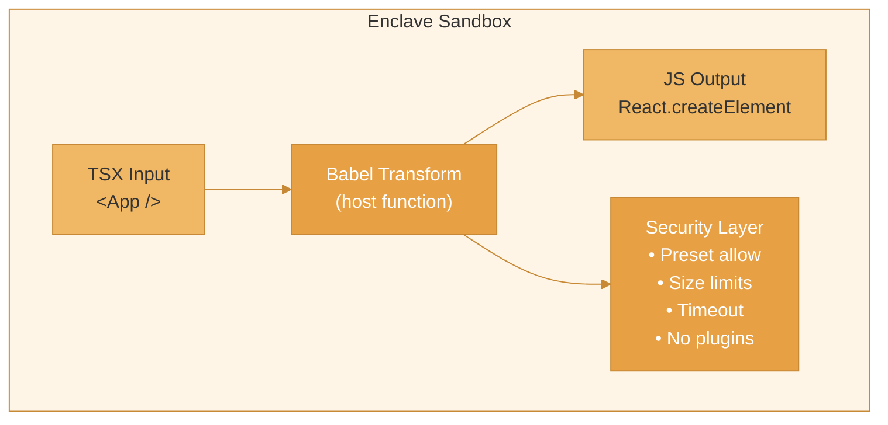

The Babel transform feature lets a script inside the enclave sandbox turn TSX/JSX into JavaScript. The script calls a restricted `Babel.transform()`; the source it passes is parsed and printed as data and is never executed by the transform.

## Overview



## Quick Start

```ts
import { Enclave } from '@enclave-vm/core';

// Create enclave with babel preset
const enclave = new Enclave({
  preset: 'babel',
  securityLevel: 'STANDARD',
});

// Transform TSX inside the sandbox
const result = await enclave.run(`
  const tsx = \`
    interface Props { name: string; }
    const Greeting = ({ name }: Props) => <h1>Hello, {name}!</h1>;
  \`;

  const transformed = Babel.transform(tsx, {
    presets: ['typescript', 'react'],
    filename: 'Greeting.tsx',
  });

  return transformed.code;
`);

console.log(result.value);
// Output: const Greeting = ({ name }) => /*#__PURE__*/React.createElement("h1", null, "Hello, ", name, "!");

enclave.dispose();
```

## Security Model

The `Babel` global holds functions of the host, which the enclave hands to the script like any other function in `globals`. `@babel/standalone` is loaded into the host realm and runs there, with the host's intrinsics and the host's authority. It is called from a separate VM context, and what that context provides is the timeout of the call: it is not an isolation boundary, and it takes nothing away from Babel. A defect in Babel's parser or in a preset would be a defect in host code. A host that needs Babel isolated from its process runs the enclave in a process of its own.

What a script can make Babel do is restricted by what the wrapper passes on and checks:

| Restriction | Description |
|-------------|-------------|
| **Source is data** | Babel parses and prints the text; it never executes it |
| **Preset allowlist** | Only the presets of the security level can be used |
| **No plugins** | Plugins are always none (a plugin is code that runs in the transform) |
| **No configuration files, source maps or AST** | `babelrc` and `configFile` are off; the result is the code only |
| **Input size limit** | Maximum source size, by security level |
| **Output size limit** | Maximum output size, by security level; an output over the limit is refused before an import rewrite reads it, and the final text is checked again |
| **Transform timeout** | Per transform, by security level |
| **Sanitized file name** | Path separators, `..` and characters that are invalid in a file name are removed, and the name is cut to 255 characters |
| **Bounded error text** | Babel's message for a failed transform is cut to 2,000 characters, with host paths and stack locations removed |

## Configuration

### Security Levels

Each security level provides different limits for Babel transforms:

| Security Level | Max Input | Max Output | Timeout | Allowed Presets |
|----------------|-----------|------------|---------|-----------------|
| `STRICT` | 100 KB | 500 KB | 5s | `react` only |
| `SECURE` | 500 KB | 2 MB | 10s | `typescript`, `react` |
| `STANDARD` | 1 MB | 5 MB | 15s | `typescript`, `react` |
| `PERMISSIVE` | 5 MB | 25 MB | 30s | `typescript`, `react`, `env` |

```ts
import { Enclave } from '@enclave-vm/core';
import { getBabelConfig } from '@enclave-vm/ast';

// Get config for a security level
const config = getBabelConfig('SECURE');
console.log(config);
// {
//   maxInputSize: 524288,     // 500 KB
//   maxOutputSize: 2097152,   // 2 MB
//   transformTimeout: 10000,  // 10 seconds
//   allowedPresets: ['typescript', 'react']
// }
```

### Creating a Babel Enclave

```ts
const enclave = new Enclave({
  preset: 'babel',           // Enable Babel preset
  securityLevel: 'STANDARD', // Choose security level
});
```

## Transform API

Inside the enclave, the `Babel` global provides a restricted transform API:

```ts
interface SafeTransformOptions {
  filename?: string;                    // For error messages (sanitized)
  presets?: string[];                   // Must be in allowed list
  sourceType?: 'module' | 'script';     // Default: 'module'
  importRewrite?: ImportRewriteConfig;  // Rewrite npm imports to CDN URLs (see below)
}

interface SafeTransformResult {
  code: string;                         // Transformed JavaScript
}

// Usage inside enclave
const result = Babel.transform(code, options);
```

### Transform Options

| Option | Type | Default | Description |
|--------|------|---------|-------------|
| `filename` | `string` | `'input.tsx'` | Filename for error messages |
| `presets` | `string[]` | `[]` | Babel presets to apply |
| `sourceType` | `'module' \| 'script'` | `'module'` | How to parse the code |
| `importRewrite` | `ImportRewriteConfig` | - | Rewrite imports of npm packages to URLs below `cdnBaseUrl` |

<Warning>
  The following Babel options are not passed on, whatever a script supplies:
  - `plugins` - always none (a plugin is code that runs in the transform)
  - `sourceMaps` - off (a source map names paths)
  - `ast` - off (the result is the code only)
  - `babelrc` / `configFile` - off (no configuration file is read)
</Warning>

### Timeout

The transform timeout of the security level applies to each transform, not to an execution: a script that calls `Babel.transform()` several times, or `Babel.transformMultiple()` with several files, gets the timeout for every call and for every file. A transform that runs into it fails with `Babel transform timed out after <timeout>ms`.

### Multiple Files

`Babel.transformMultiple(files, options)` transforms a set of files that import each other and returns `{ files, dependencies, warnings, rewrittenImports }`:

- A file name is at most 255 characters, relative, without `..`, made of letters, digits, `_`, `-`, `/` and `.`, and ends in `.ts`, `.tsx`, `.js`, `.jsx`, `.mjs`, `.cjs`, `.mts` or `.cts`. Any other name is refused.
- The number of files and the total input and output size are limited by security level (3 files at `STRICT`, 10 at `SECURE`, 25 at `STANDARD`, 100 at `PERMISSIVE`).
- `dependencies` lists each local file a file imports once, however many imports name it.

### Import Rewriting

With `importRewrite: { enabled: true, cdnBaseUrl, packageVersions }` the transformed code has its imports of npm packages rewritten to URLs below `cdnBaseUrl`:

- Only allowed packages can be imported: the ones in `allowedPackages` when that list is given, otherwise the ones named in `packageVersions`. An import of another package fails the transform. This holds for import declarations, re-exports and dynamic `import()`.
- A dynamic `import('pkg')` of an allowed package is rewritten like a static import. A dynamic import whose specifier is not written as a string (a string literal, or a template literal without substitutions) cannot be checked and is refused.
- Local imports (`./foo`, `../bar`) are left as they are by default.
- `cdnBaseUrl` must be an HTTPS URL without credentials, query or fragment, and a version is a version number, range or tag without path or URL characters.

The allowlist belongs to whoever writes the configuration. A script that passes `importRewrite` to `Babel.transform()` itself chooses its own allowlist, so there the rewrite is a convenience and restricts nothing: treat the output as the script's own text.

## Common Use Cases

### Transform React Components

```ts
const code = `
  const tsx = \`
    const Button = ({ onClick, children }) => (
      <button className="btn" onClick={onClick}>
        {children}
      </button>
    );
  \`;

  return Babel.transform(tsx, {
    presets: ['react'],
    filename: 'Button.jsx',
  }).code;
`;

const result = await enclave.run(code);
// Result: React.createElement("button", { className: "btn", onClick }, children)
```

### Transform TypeScript + JSX

```ts
const code = `
  const tsx = \`
    interface UserCardProps {
      user: { name: string; email: string; };
      onEdit?: () => void;
    }

    const UserCard = ({ user, onEdit }: UserCardProps) => (
      <div className="user-card">
        <h2>{user.name}</h2>
        <p>{user.email}</p>
        {onEdit && <button onClick={onEdit}>Edit</button>}
      </div>
    );
  \`;

  return Babel.transform(tsx, {
    presets: ['typescript', 'react'],
    filename: 'UserCard.tsx',
  }).code;
`;

const result = await enclave.run(code);
// TypeScript types are stripped, JSX is transformed
```

### Tool Integration for Dynamic Components

```ts
const enclave = new Enclave({
  preset: 'babel',
  securityLevel: 'STANDARD',
  toolHandler: async (toolName, args) => {
    if (toolName === 'component:fetch') {
      // Fetch TSX from database, API, or LLM
      return `<Card title="${args.title}"><p>Content</p></Card>`;
    }
    return null;
  },
});

const code = `
  // Fetch component TSX from external source
  const tsx = await callTool('component:fetch', { title: 'Welcome' });

  // Transform to JavaScript
  const js = Babel.transform(tsx, {
    presets: ['react'],
    filename: 'Card.jsx',
  }).code;

  return js;
`;

const result = await enclave.run(code);
```

## Error Handling

The message of a failed transform is `Babel transform failed: ` followed by Babel's message with host paths and stack locations removed, cut to 2,000 characters (Babel quotes the source around a syntax error, so its message can be as long as the source):

```ts
const code = `
  try {
    // Invalid JSX
    Babel.transform('<div', { presets: ['react'] });
  } catch (error) {
    return error.message;
  }
`;

const result = await enclave.run(code);
// The message names the problem; it holds no host path
```

### Common Errors

| Error | Cause | Solution |
|-------|-------|----------|
| `Preset "X" is not allowed` | Using disallowed preset | Use preset from allowed list |
| `Code exceeds maximum size` | Input too large | Reduce input or use higher security level |
| `Output exceeds maximum size` | Transform produced too much output | Simplify input code |
| `Babel transform timed out after Nms` | One transform took longer than the level's transform timeout | Simplify the code or use a higher security level |
| `Code contains invalid null bytes` | The source contains a null byte | Clean input before transform |
| `Import rewrite failed: Package "X" is not allowed` | An import of a package that is not on the allowlist | List the package in `allowedPackages` when that list is given, otherwise in `packageVersions` |
| `Import rewrite failed: Dynamic import() is only allowed with a string literal as its specifier` | A dynamic import whose specifier is computed | Write the specifier as a string literal; listing a package does not help |
| `Import rewrite failed: Invalid version for package "X"` | A version in `packageVersions` with path or URL characters | Give a version number, a range or a tag, or an empty string for the latest version |
| `Import rewrite failed: CDN URL must use HTTPS` or `Invalid CDN URL` | `cdnBaseUrl` is not an HTTPS URL, or holds credentials, a query or a fragment | Give an `https:` URL made of a host and, optionally, a path |

## Performance

Babel transforms are optimized with context caching:

| Operation | Typical Latency | Throughput |
|-----------|----------------|------------|
| Simple component (L1) | ~0.6ms | 1400+ transforms/sec |
| Props + types (L2) | ~0.9ms | 1100+ transforms/sec |
| Styled components (L3) | ~0.8ms | 1200+ transforms/sec |
| Composite patterns (L4) | ~1.2ms | 700+ transforms/sec |
| Complex TypeScript (L5) | ~2.2ms | 350+ transforms/sec |

<Tip>
  The Babel context is cached between transforms. The first transform (cold start) takes ~20-50ms, subsequent transforms are much faster.
</Tip>

### Performance Tips

1. **Batch transforms** - Transform multiple components in a single enclave run
2. **Reuse enclave** - Don't create/dispose for each transform
3. **Minimize types** - Complex TypeScript types increase transform time
4. **Use STANDARD level** - Good balance of security and performance

```ts
// Good: Reuse enclave for multiple transforms
const enclave = new Enclave({ preset: 'babel' });

const components = ['Button', 'Card', 'Modal'];
const results = await enclave.run(`
  const components = ${JSON.stringify(componentCode)};
  return components.map(tsx =>
    Babel.transform(tsx, { presets: ['react'] }).code
  );
`);

enclave.dispose();
```

## Direct API (Outside Enclave)

For server-side use without the full enclave sandbox, use `createRestrictedBabel`:

```ts
import { createRestrictedBabel } from '@enclave-vm/core';
import { getBabelConfig } from '@enclave-vm/ast';

const config = getBabelConfig('STANDARD');
const babel = createRestrictedBabel(config);

const result = babel.transform(tsxCode, {
  presets: ['typescript', 'react'],
  filename: 'Component.tsx',
});

console.log(result.code);
```

<Warning>
  The direct API applies the same restrictions to a transform (preset allowlist, no plugins, size limits, the timeout). Babel runs in the host realm here as well. It transforms text and runs none of it; to run LLM-generated code, use the enclave.
</Warning>

## Related

- [Overview](/core-libraries/enclave-vm/overview) - Enclave introduction
- [Security Levels](/core-libraries/enclave-vm/security-levels) - Security profiles
- [AgentScript Preset](/core-libraries/ast-guard/agentscript-preset) - AST validation for enclave code
- [Tool System](/core-libraries/enclave-vm/tool-system) - Integrating tools with enclave
