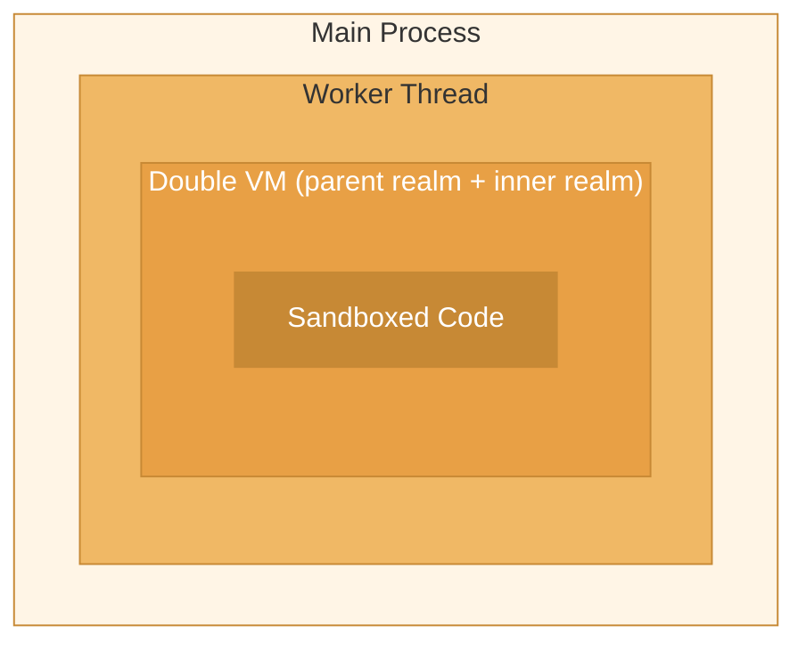

The worker threads adapter runs each script in a worker thread taken from a pool. Inside the worker the script runs in the same sandbox as in process (the [double VM](/core-libraries/enclave-vm/double-vm) by default). The worker adds two things a separate thread can provide: a heap limit that the engine enforces, and a stop that does not depend on the script.

A worker thread is not a sandbox by itself and not process isolation: it has the Node.js API and shares the process with the host. For tenants that must not share a process, run one enclave per process or container.

## Basic Usage

```ts
import { Enclave } from '@enclave-vm/core';

const enclave = new Enclave({
  adapter: 'worker_threads',
  workerPoolConfig: {
    minWorkers: 2,
    maxWorkers: 8,
    memoryLimitPerWorker: 256 * 1024 * 1024, // 256MB
  },
});
```

## Worker Pool Features

- **Pool management** - Auto-scaling with min/max workers
- **Heap limit** - A worker that exceeds `memoryLimitPerWorker` is terminated and replaced: by the engine, or by the pool when the process runs with `--max-old-space-size` (see [The heap limit](#the-heap-limit))
- **Memory monitoring** - A worker that holds more than its limit allows (its own heap and external memory, not the size of the process) is recycled
- **Hard halt** - A script that is still running five seconds after its `timeout` is terminated with its worker
- **Rate and size limits** - The messages a worker may send per second while it runs one execution, and the size of one message
- **The same sandbox** - The double VM runs inside the worker; tool calls go through the host's tool bridge
- **Untrusted workers** - The host checks every message from a worker against the protocol schema
- **A clean worker for every execution** - A worker goes back into the pool only when it has confirmed that nothing of the last script is left in it (see [How an Execution Ends](#how-an-execution-ends))

## Worker Pool Presets

| Setting                | STRICT | SECURE | STANDARD | PERMISSIVE |
| ---------------------- | ------ | ------ | -------- | ---------- |
| maxWorkers             | 4      | 8      | 16       | 32         |
| memoryLimitPerWorker   | 64MB   | 128MB  | 256MB    | 512MB      |
| maxExecutionsPerWorker | 100    | 500    | 1,000    | 5,000      |
| maxQueueSize           | 20     | 50     | 100      | 500        |
| maxMessagesPerSecond   | 100    | 500    | 1,000    | 5,000      |
| maxPendingToolCalls    | 10     | 50     | 100      | 1,000      |
| maxMessageSizeBytes    | 1MB    | 4MB    | 16MB     | 64MB       |

## Using Presets

The pool takes the preset of the enclave's `securityLevel`; `workerPoolConfig` overrides single settings of it. The presets are exported as `WORKER_POOL_PRESETS`.

```ts
import { Enclave, WORKER_POOL_PRESETS } from '@enclave-vm/core';

// The STRICT preset: follows from the security level
const enclave = new Enclave({
  securityLevel: 'STRICT',
  adapter: 'worker_threads',
});

// Override a setting of the level's preset
const customEnclave = new Enclave({
  securityLevel: 'SECURE',
  adapter: 'worker_threads',
  workerPoolConfig: {
    maxWorkers: 16,
  },
});

console.log(WORKER_POOL_PRESETS.SECURE.memoryLimitPerWorker); // 134217728
```

## Configuration Options

```ts
interface WorkerPoolConfig {
  // Pool sizing
  minWorkers: number;        // Minimum workers to keep warm
  maxWorkers: number;        // Maximum concurrent workers; further executions wait in the queue

  // Resource limits
  memoryLimitPerWorker: number;  // Heap limit per worker (bytes); 0 for none
  maxExecutionsPerWorker: number; // Executions before worker recycle

  // Queue management
  maxQueueSize: number;      // Maximum pending executions
  queueTimeoutMs: number;    // Queue wait timeout (ms)

  // Messages from a worker
  maxMessagesPerSecond: number;  // Messages per second while a worker runs one execution
  maxPendingToolCalls: number;   // Tool calls one execution may have in flight
  maxMessageSizeBytes: number;   // Largest single message (bytes)

  // Lifecycle
  idleTimeoutMs: number;     // Time before idle worker shutdown
  gracefulShutdownTimeoutMs: number; // How long an idle worker that was asked to exit gets
  memoryCheckIntervalMs: number;     // Interval of the memory monitor (ms)
  warmOnInit: boolean;       // Start minWorkers workers when the pool is created (default true)
}
```

`maxMessagesPerSecond` is counted per execution: what an earlier execution sent from the same worker is not held against the next one. The result of an execution and the worker's confirmation that it is idle are not counted.

`maxMessageSizeBytes` is applied before a message is parsed. The limit an execution gets is never below what the enclave's own limits let one message carry: a tool request (`toolBridge.maxPayloadBytes`) or a result (`memoryLimit`). So it decides where those are larger than it, or off: with `memoryLimit: 0` it is the only bound on the size of a result.

## How an Execution Ends

A worker runs one execution at a time. When the script has returned, the worker sends its result and then confirms that it is idle, which it can only do when nothing of the script keeps its thread busy. The pool hands a worker to the next execution only after that confirmation. A worker that does not confirm within one second is terminated and replaced; the result it sent stands.

In every case where the pool ends an execution itself, it ends the worker with it and starts a new one. `run()` then returns a failure with `error.code` `EXECUTION_ERROR` and one of these in `error.name`:

| `error.name` | When |
| ------------ | ---- |
| `WorkerTimeoutError` | The script was still running five seconds after its `timeout` |
| `WorkerMemoryError` | The worker held more than its memory budget while it executed (see [The heap limit](#the-heap-limit)) |
| `MessageFloodError` | The execution sent more than `maxMessagesPerSecond` messages (tool calls, console output) |
| `MessageSizeError` | A message from the worker was larger than the limit |
| `TooManyPendingCallsError` | More than `maxPendingToolCalls` tool calls were in flight |
| `MessageValidationError` | A message from the worker did not pass the protocol schema |
| `WorkerCrashedError` | The worker exited unexpectedly while it ran the script |
| `ExecutionAbortedError` | The pool was disposed while the execution was in flight, or the script's time had passed before a worker was free (the script is then not started) |
| `QueueFullError`, `QueueTimeoutError` | No worker became free: the queue was full, or the wait exceeded `queueTimeoutMs` |

A worker that the engine ends at its heap limit fails its execution with the engine's own out-of-memory error for the worker. `enclave.dispose()` ends the executions that are in flight with `ExecutionAbortedError` and terminates every worker, so a disposed pool leaves nothing running.

## What a Worker Adds

1. **Separate V8 heap** - Each worker has its own heap, with its own limit (`resourceLimits`)
2. **Memory limit** - A script that outgrows the limit loses its worker, and the pool goes on with a new one
3. **Hard stop** - `worker.terminate()` ends a script that nothing else can interrupt
4. **Recovery** - A worker that is terminated or dies is removed from the pool and replaced

### The heap limit

`memoryLimitPerWorker` limits the worker's old generation. The engine allows the young generation on top of it, which the pool sets to 24 MB, so the most a worker can hold is the sum of the two.

- **A heap flag on the process replaces it.** When the host process runs with `--max-old-space-size` (on the command line or in `NODE_OPTIONS`), that value becomes the heap limit of every worker thread, whatever limit a worker was created with. The pool reads the actual limit of each new worker. When the engine does not apply the configured one, it logs a warning once and enforces the limit itself: it reads the worker's heap every 100 ms while the worker executes and terminates it past its limit (`WorkerMemoryError`). This is approximate, and it needs Node.js 22.16 or later; on an older 22.x the pool can only warn that the limit is not enforced.
- **Memory outside the heap counts while a worker executes.** The engine's limit covers the heap. On Node.js 22.16 or later the pool also reads, every 100 ms, what the worker holds in its heap and in external memory together, and ends the execution with `WorkerMemoryError` when that is more than the worker's budget (the limit plus the young generation). The read needs no answer from the worker, so a script that keeps its thread busy does not delay it.
- **It is not a guarantee that the host process survives.** A worker thread shares the process, and Node.js states that a process may still abort with these limits set: an allocation burst that outruns the engine's shutdown of the worker is a fatal out-of-memory error for the whole process. Inside the sandbox, with the worker's limit in effect, this has not been observed, and by default the sandbox's own `memoryLimit` stops a script long before the worker's limit. A host that must survive whatever a script allocates runs the enclave in a child process or a container with a memory limit of the operating system.

## What Is Different From In-Process Execution

- **Custom globals** reach a worker as JSON data. Functions in `globals` are not available there.
- **Tool names** must start with a letter and contain only letters, digits, `:`, `.`, `_` and `-`. A call with another name fails with an error the script can catch.
- **Console output** without a `consoleHandler` is printed by the host with a `[Worker]` prefix.
- **`toolBridge.mode: 'direct'`** does not apply: tool requests and responses cross as strings.

## When to Use Worker Pool

Use the worker pool adapter when:

- Running code from completely untrusted sources
- You need a script to be stopped even if it cannot be interrupted
- A heap limit per worker is wanted as a backstop behind the sandbox's own `memoryLimit`
- Processing many concurrent executions

Use the default VM adapter when:

- You need lower latency
- Running trusted or semi-trusted code
- Simpler deployment is preferred

## Layers

The script runs in the double VM, inside a worker thread:



1. **Worker Thread** - Heap limit, hard stop
2. **Double VM** - The sandbox: allowed globals only, membrane, tool gate, limits

Messages between the worker and the main thread are JSON. The script's return value is converted as on the in-process adapters (same `maxSanitizeDepth` and `maxSanitizeProperties` limits, `'[Circular]'`, BigInt to string, Map to object, Set to array), and the values JSON cannot carry (`Date`, `NaN`, `Infinity`, `undefined`) are sent alongside it and restored, so a `Date` comes back as a `Date`.

## Monitoring Worker Health

The pool has no callbacks. It keeps counters, which you read from the pool object, so create the pool yourself and hand it to the enclave as its adapter:

```ts
import { Enclave, WorkerPoolAdapter } from '@enclave-vm/core';

const pool = new WorkerPoolAdapter({ maxWorkers: 8, memoryLimitPerWorker: 256 * 1024 * 1024 }, 'STANDARD');

const enclave = new Enclave({
  securityLevel: 'STANDARD', // the same level as the pool
  sandboxAdapter: pool,
});

const monitor = setInterval(() => {
  const metrics = pool.getMetrics();
  console.log('Workers:', metrics.totalSlots, 'executing:', metrics.executingSlots);
  console.log('Queue depth:', metrics.queuedRequests);
  console.log('Recycled:', metrics.workerRecycles, 'ended for memory:', metrics.memoryKills);
  console.log('Timed out:', metrics.timeoutExecutions, 'of', metrics.totalExecutions);
}, 10_000);

// On shutdown: stop the timer (it would keep the process alive and go on reporting a pool
// that is gone), then dispose. An adapter you passed in is yours to dispose.
clearInterval(monitor);
enclave.dispose();
pool.dispose();
```

`memoryKills` counts every worker that was ended at its memory limit: by the engine, by the pool's own heap check, or by the memory monitor.

A pool created this way runs each script in the double VM, like `adapter: 'worker_threads'` with default options; its third constructor argument takes a `doubleVm` configuration.

## Related

- [Security Levels](/core-libraries/enclave-vm/security-levels) - Security presets
- [Double VM](/core-libraries/enclave-vm/double-vm) - Additional security layer
- [Configuration](/core-libraries/enclave-vm/configuration) - All configuration options
