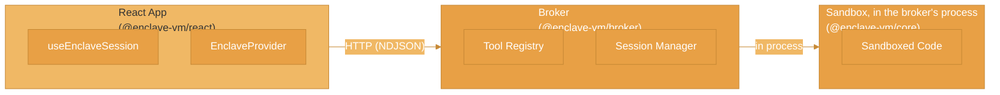

# EnclaveJS Streaming Runtime

EnclaveJS is a streaming runtime layer built on top of `@enclave-vm/core` that enables real-time code execution with tool orchestration, session management, and client SDKs for browser and React applications.

## Architecture

A client sends a script to a broker over HTTP. The broker runs it in an `@enclave-vm/core` sandbox in its own process, runs the tools the script calls, and streams the events of the session back:



`@enclave-vm/runtime` is not part of this picture: it holds building blocks of a separate runtime worker and does not execute scripts yet.

## Packages

<CardGroup cols={2}>
  <Card title="@enclave-vm/types" icon="code" href="/enclavejs/types">
    Protocol types and Zod schemas for the streaming runtime
  </Card>
  <Card title="@enclave-vm/stream" icon="wave-pulse" href="/enclavejs/stream">
    NDJSON streaming, reconnection helpers, and encryption primitives
  </Card>
  <Card title="@enclave-vm/broker" icon="server" href="/enclavejs/broker">
    Tool broker with session management and HTTP API
  </Card>
  <Card title="@enclave-vm/client" icon="plug" href="/enclavejs/client">
    Browser and Node.js client SDK
  </Card>
  <Card title="@enclave-vm/react" icon="react" href="/enclavejs/react">
    React hooks and components
  </Card>
  <Card title="@enclave-vm/runtime" icon="microchip" href="/enclavejs/runtime">
    Building blocks of a runtime worker; not a runnable service
  </Card>
</CardGroup>

## Key Features

- **Real-time Streaming**: NDJSON-based protocol that streams the events of a session (tool calls, progress, the result)
- **Tool Orchestration**: Define tools with Zod schemas on the broker, which runs them when a script calls them
- **Session Management**: Track execution sessions with limits, stats, and lifecycle management
- **Bring your own authentication**: The broker does not authenticate callers or limit request rates; with its `identify` hook a session belongs to the caller that created it
- **Encryption Primitives**: ECDH, HKDF and AES-256-GCM building blocks in `@enclave-vm/stream`. The client and broker do not encrypt: sessions are plain JSON protected by HTTPS
- **Automatic Reconnection**: Built-in reconnection with sequence tracking and event buffering
- **React Integration**: First-class React hooks for building interactive code execution UIs

## Quick Start

### Server Setup (Broker)

```typescript
import { createBroker } from '@enclave-vm/broker';
import { z } from 'zod';

const broker = createBroker({
  enclave: { securityLevel: 'SECURE' },
});

// Register a tool
broker.tool('getCurrentTime', {
  description: 'Get the current time',
  argsSchema: z.object({
    timezone: z.string().optional(),
  }),
  handler: async ({ timezone }) => {
    return new Date().toLocaleString('en-US', { timeZone: timezone });
  },
});

// Execute code; the events of the run go to onEvent
const result = await broker.execute(
  `
  const time = await callTool('getCurrentTime', { timezone: 'America/New_York' });
  return time;
`,
  {
    onEvent: (event) => console.log(event.type, event.payload),
  },
);

console.log(result.success ? result.value : result.error);
```

To serve sessions over HTTP for the client, register the broker's routes on an Express app; see [@enclave-vm/broker](/enclavejs/broker#http-api).

### Client Setup (React)

```tsx
import { EnclaveProvider, useEnclaveSession } from '@enclave-vm/react';

function App() {
  return (
    <EnclaveProvider config={{ baseUrl: 'http://localhost:3000' }}>
      <CodeExecutor />
    </EnclaveProvider>
  );
}

function CodeExecutor() {
  const { execute, state, result, error } = useEnclaveSession();

  const runCode = async () => {
    await execute(`
      const time = await callTool('getCurrentTime', {});
      return time;
    `);
  };

  return (
    <div>
      <button onClick={runCode} disabled={state === 'running'}>
        {state === 'running' ? 'Running...' : 'Run Code'}
      </button>
      {result?.success && <div>Result: {JSON.stringify(result.value)}</div>}
      {error && <div>Error: {error.message}</div>}
    </div>
  );
}
```

## Deployment

The broker runs the sandbox in its own process. There is no mode option: `createBroker()` takes `enclave`, `limits`, `history` and `sessions`.

```typescript
const broker = createBroker({
  enclave: { securityLevel: 'SECURE' },
  limits: { maxToolCalls: 20, toolTimeoutMs: 10_000 },
});
```

A session runs on the broker's thread. A script that computes without calling a tool holds that thread, and with it every other session, until it ends or reaches `toolTimeoutMs`. When you serve callers you do not trust, keep that limit low and run the broker in a process of its own, or give the sandbox the worker-pool adapter (`enclave: { adapter: 'worker_threads' }`).

A deployment in which the broker hands execution to a separate runtime worker is not implemented: the broker has no option to connect to one, and `@enclave-vm/runtime` rejects an `execute` request with `RuntimeNotImplementedError`.

## Stream Events

The streaming protocol emits these event types:

| Event Type | Description |
|------------|-------------|
| `session_init` | Session started: cancel URL and expiry |
| `tool_call` | The script called a tool |
| `tool_progress` | Progress of a tool call |
| `tool_result_applied` | The tool result was handed to the script |
| `partial_result` | Part of a result |
| `heartbeat` | Keep-alive message |
| `deadline_exceeded` | The deadline of the session passed |
| `final` | Session ended, with the result or the error, and stats |
| `error` | An error next to the final event, such as a cancellation |

The protocol also defines `stdout` and `log` events; the broker does not emit them. See [Streaming Protocol](/concepts/streaming-protocol).

## Links

- [GitHub](https://github.com/agentfront/enclave)
- [npm @enclave-vm](https://www.npmjs.com/org/enclave-vm)
