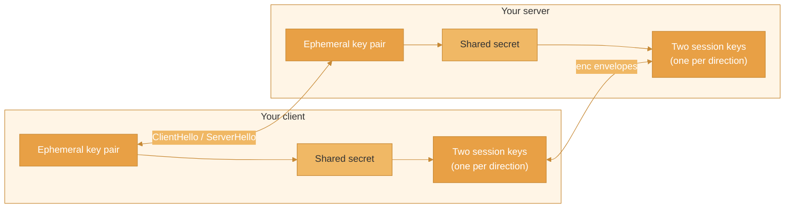

This example wires the encryption primitives of `@enclave-vm/stream` by hand between a client and a server that you write yourself: a key exchange, two session keys, and `enc` envelopes around the messages.

<Warning>
  Read this before using the example:

  - **The EnclaveJS client and broker do not do this.** `@enclave-vm/client`, `@enclave-vm/react`, `@enclave-vm/broker` and `@enclave-vm/runtime` do not encrypt, perform no handshake and have no encryption option. Both endpoints below are your own code.
  - **The key exchange is not authenticated.** It protects against a party that can only read the connection. A party that can change messages can replace both public keys.
  - **The server reads the code.** The server you send code to has to decrypt it to run it, and it sees the results. Encryption covers the path between the two endpoints, not the server.
  - **TLS is still required.** Serve both endpoints over HTTPS. The envelopes are a layer on top of TLS, not a replacement for it.
</Warning>

## Overview



The example has two endpoints:

- `POST /handshake` takes a `ClientHello` and answers with a session id and a `ServerHello`.
- `POST /execute` takes one `enc` envelope with the code and answers with an NDJSON stream of `enc` envelopes.

## Messages

The content of an envelope can be any JSON value. This example uses its own small messages:

```ts
// messages.ts
export interface ExecuteMessage {
  code: string;
}

export type ServerMessage =
  | { type: 'tool_call'; toolName: string }
  | { type: 'result'; success: true; value: unknown }
  | { type: 'result'; success: false; error: string };
```

## Server

```ts
// server.ts
import express from 'express';
import { Enclave } from '@enclave-vm/core';
import {
  ClientHelloSchema,
  EncryptedEnvelopeSchema,
  SessionEncryptionContext,
  deriveSessionKeys,
  deriveSharedSecret,
  generateSessionId,
  processClientHello,
  serializeEvent,
  type SessionId,
} from '@enclave-vm/stream';
import type { ExecuteMessage, ServerMessage } from './messages';

interface EncryptedSession {
  sessionId: SessionId;
  /** Opens what the client sends (client-to-server key) */
  incoming: SessionEncryptionContext;
  /** Encrypts what the server sends (server-to-client key) */
  outgoing: SessionEncryptionContext;
  createdAt: number;
}

const sessions = new Map<string, EncryptedSession>();

const app = express();
app.use(express.json());

// Handshake: ClientHello in, session id and ServerHello out
app.post('/handshake', async (req, res) => {
  const hello = ClientHelloSchema.safeParse(req.body?.clientHello);
  if (!hello.success) {
    res.status(400).json({ error: 'Invalid client hello' });
    return;
  }

  try {
    // Generates the server's ephemeral key pair, a key id and the ServerHello.
    // Throws EcdhError for a protocol version, curve or algorithm that is not implemented.
    const { serverKeyPair, peerPublicKey, serverHello, keyId } = await processClientHello(hello.data);

    const sessionId = generateSessionId();
    const sharedSecret = await deriveSharedSecret(serverKeyPair.privateKey, peerPublicKey);

    // Two keys, one per direction, and one context for each
    const { clientToServerKey, serverToClientKey } = await deriveSessionKeys(sharedSecret, sessionId);

    sessions.set(sessionId, {
      sessionId,
      incoming: await SessionEncryptionContext.fromKeyBytes(clientToServerKey, keyId),
      outgoing: await SessionEncryptionContext.fromKeyBytes(serverToClientKey, keyId),
      createdAt: Date.now(),
    });

    res.json({ sessionId, serverHello });
  } catch {
    res.status(400).json({ error: 'Handshake failed' });
  }
});

// Execute: one `enc` envelope with the code in, NDJSON of `enc` envelopes out
app.post('/execute', async (req, res) => {
  const parsed = EncryptedEnvelopeSchema.safeParse(req.body);
  const session = parsed.success ? sessions.get(parsed.data.sessionId) : undefined;
  if (!parsed.success || !session) {
    res.status(400).json({ error: 'Invalid request' });
    return;
  }

  let message: ExecuteMessage;
  try {
    // Throws AesGcmError when the ciphertext or a header field of the envelope
    // (protocol version, session id, sequence number, key id) was changed
    message = await session.incoming.openEnvelope<ExecuteMessage>(parsed.data);
  } catch {
    res.status(400).json({ error: 'Invalid request' });
    return;
  }

  // Opening an envelope does not tell whether it was seen before. Here a session
  // serves one execution: an envelope that arrives again finds no session.
  if (!sessions.delete(session.sessionId) || typeof message?.code !== 'string') {
    res.status(400).json({ error: 'Invalid request' });
    return;
  }

  res.setHeader('Content-Type', 'application/x-ndjson');

  // Envelopes are numbered 1, 2, 3, ... and written in that order
  let seq = 0;
  let queue: Promise<void> = Promise.resolve();
  const send = (event: ServerMessage): Promise<void> => {
    queue = queue.then(async () => {
      const envelope = await session.outgoing.createEnvelope(session.sessionId, ++seq, event);
      res.write(serializeEvent(envelope) + '\n');
    });
    return queue;
  };

  const enclave = new Enclave({
    securityLevel: 'STRICT',
    toolHandler: async (toolName, args) => {
      await send({ type: 'tool_call', toolName });
      return executeTool(toolName, args); // your own tool dispatcher
    },
  });

  try {
    // The server runs the code, so it reads it
    const result = await enclave.run(message.code);
    await send(
      result.success
        ? { type: 'result', success: true, value: result.value }
        : { type: 'result', success: false, error: result.error?.message ?? 'Execution failed' },
    );
  } catch {
    // The stream ends without a result; the client treats that as a failure
  } finally {
    enclave.dispose();
    res.end();
  }
});

// Forget handshakes that were not used
setInterval(() => {
  const now = Date.now();
  for (const [id, session] of sessions) {
    if (now - session.createdAt > 60_000) {
      sessions.delete(id);
    }
  }
}, 10_000);
```

## Client

```ts
// client.ts
import {
  ServerHelloSchema,
  SessionEncryptionContext,
  createClientHello,
  deriveSessionKeys,
  deriveSharedSecret,
  generateKeyPair,
  isSessionId,
  parseNdjsonStream,
  processServerHello,
} from '@enclave-vm/stream';
import type { ExecuteMessage, ServerMessage } from './messages';

export async function executeEncrypted(baseUrl: string, code: string): Promise<unknown> {
  // 1. Handshake: send a ClientHello, receive the session id and a ServerHello
  const clientKeys = await generateKeyPair();
  const clientHello = await createClientHello(clientKeys);

  const handshake = await fetch(`${baseUrl}/handshake`, {
    method: 'POST',
    headers: { 'Content-Type': 'application/json' },
    body: JSON.stringify({ clientHello }),
  });
  if (!handshake.ok) {
    throw new Error(`Handshake failed: ${handshake.status}`);
  }

  const { sessionId, serverHello } = await handshake.json();
  if (typeof sessionId !== 'string' || !isSessionId(sessionId)) {
    throw new Error('Invalid handshake response');
  }

  // Throws EcdhError for a protocol version, curve, algorithm or key derivation
  // that is not implemented. Nothing here proves who sent the ServerHello.
  const { peerPublicKey, keyId } = await processServerHello(ServerHelloSchema.parse(serverHello));

  // 2. Two keys, one per direction, and one context for each
  const sharedSecret = await deriveSharedSecret(clientKeys.privateKey, peerPublicKey);
  const { clientToServerKey, serverToClientKey } = await deriveSessionKeys(sharedSecret, sessionId);
  const outgoing = await SessionEncryptionContext.fromKeyBytes(clientToServerKey, keyId);
  const incoming = await SessionEncryptionContext.fromKeyBytes(serverToClientKey, keyId);

  // 3. Send the code in an `enc` envelope
  const request: ExecuteMessage = { code };
  const response = await fetch(`${baseUrl}/execute`, {
    method: 'POST',
    headers: { 'Content-Type': 'application/json' },
    body: JSON.stringify(await outgoing.createEnvelope(sessionId, 1, request)),
  });
  if (!response.ok || !response.body) {
    throw new Error(`Execution failed: ${response.status}`);
  }

  // 4. Open the envelopes of the response
  let expectedSeq = 1;
  for await (const envelope of parseNdjsonStream(response.body)) {
    if (envelope.type !== 'enc') {
      throw new Error('Expected an encrypted envelope');
    }

    // Throws AesGcmError when the ciphertext or a header field of the envelope was changed
    const message = await incoming.openEnvelope<ServerMessage>(envelope);

    // Opening an envelope does not tell whether its sequence number was seen before:
    // accept only the next one
    if (envelope.seq !== expectedSeq++) {
      throw new Error('Unexpected sequence number');
    }

    if (message.type === 'tool_call') {
      console.log('Tool called:', message.toolName);
    } else if (message.type === 'result') {
      if (!message.success) {
        throw new Error(message.error);
      }
      return message.value;
    }
  }

  throw new Error('The stream ended without a result');
}
```

## Usage Example

```ts
import { executeEncrypted } from './client';

const value = await executeEncrypted(
  'https://api.example.com',
  `
    const user = await callTool('users:get', { id: 'user-1' });
    return user.name;
  `,
);

console.log('Result:', value);
```

## What Is Left to You

The primitives encrypt and authenticate messages between two parties that already share keys. The rest is the application's work:

1. **Authenticate the key exchange** - `ServerHello.signatureB64` is neither created nor verified, and there is no key confirmation. Sign the hello messages with a key the client pins, or rely on TLS for the identity of the server.
2. **Authenticate the callers** - Both endpoints of the example accept requests from anyone. Protect them like any other API.
3. **One context per direction** - `deriveSessionKeys` returns `clientToServerKey` and `serverToClientKey`. Never use one `SessionEncryptionContext` for both directions.
4. **Check sequence numbers** - An envelope authenticates its sequence number, but the receiver decides whether a number is new. The client above accepts only the next number; `SequenceTracker` keeps the last number received when gaps are expected.
5. **Exchange keys again when a context is used up** - A `SessionEncryptionContext` refuses to encrypt after 2^30 messages (`needsRotation()` then returns `true`). There is no rotation.
6. **Protect key material** - `deriveSessionKeys` returns raw key bytes, and so does `context.toKeyInfo()`. Do not log or store them.
7. **Expire sessions** - Remove the keys of sessions that are over, as the server above does.

## Next Steps

- [@enclave-vm/stream](/enclavejs/stream) - The encryption primitives
- [Security Hardening](/guides/security-hardening) - More security practices
- [Streaming Protocol](/concepts/streaming-protocol) - Protocol details
- [Production Deployment](/guides/production-deployment) - Deploy securely
