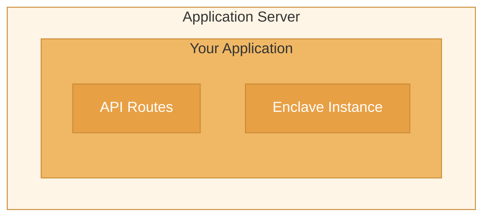
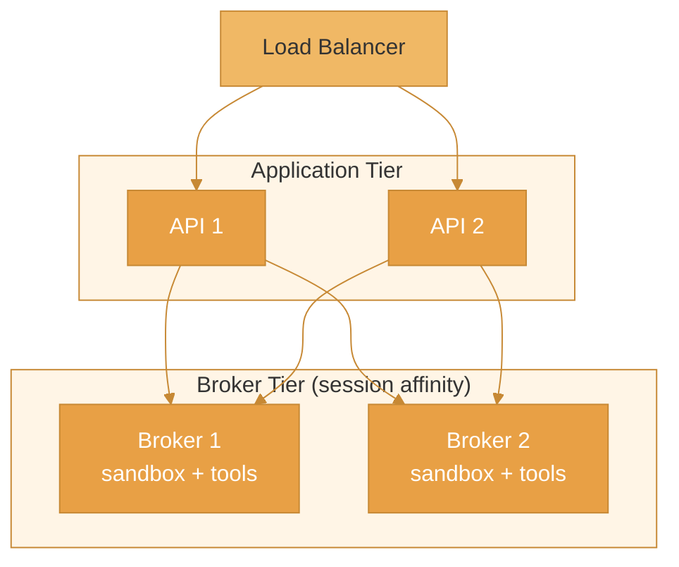

This guide covers deploying Enclave to production environments, including configuration, monitoring, and operational best practices.

## Deployment Architecture

### Single-Server Deployment

For smaller workloads:



### Several Servers

For production scale, run several instances of the server that executes scripts (your application with `@enclave-vm/core`, or an EnclaveJS broker) behind a load balancer. A session of a broker lives in the memory of the broker that created it, so route a session's later requests to the same instance. The packages have no shared session store and no separate execution tier: `@enclave-vm/runtime` does not execute scripts yet.



## Pre-Deployment Checklist

### Security

- [ ] Set `securityLevel: 'STRICT'` for untrusted code
- [ ] Configure memory limits: the sandbox's `memoryLimit` is an estimate, so give the container a limit as well
- [ ] Set appropriate timeouts
- [ ] Authenticate callers in front of every endpoint that accepts code, and in front of every session route of the EnclaveJS broker (the broker has no authentication of its own)
- [ ] Give the broker's session routes an `identify` hook, so that a session belongs to the caller that created it (see below)
- [ ] Use HTTPS: the EnclaveJS client and broker exchange plain JSON
- [ ] Enable input validation
- [ ] Review tool permissions
- [ ] Consider the AI Scoring Gate as an additional, heuristic signal

Authentication in front of the broker does not tell its routes whose session is whose: without an `identify` hook they answer every caller for every session (the list of sessions, a session's state and events, and the request to end it). The hook returns the caller your authentication found:

```ts
import { createSessionHandler, registerExpressRoutes } from '@enclave-vm/broker';

app.use(authenticate); // your middleware: checks the credential and sets req.user
registerExpressRoutes(
  app,
  createSessionHandler({
    broker,
    // request.raw is the request object of the HTTP framework
    identify: (request) => (request.raw as { user?: { id: string } }).user?.id,
  }),
);
```

A request for which the hook returns no identity is answered with `401`, and a session is answered only for the caller that created it. The hook can be left out only where a single trusted backend is the one caller of the routes. See [Who may see a session](/enclavejs/broker#who-may-see-a-session).

### Performance

- [ ] Configure worker pool for CPU-bound loads
- [ ] With several brokers, route a session's requests to the broker that created it
- [ ] Configure connection pooling
- [ ] Enable response compression
- [ ] Set up CDN for static assets

### Monitoring

- [ ] Configure logging
- [ ] Set up metrics collection
- [ ] Configure alerting
- [ ] Enable tracing
- [ ] Set up error tracking

### Infrastructure

- [ ] Configure auto-scaling
- [ ] Set up health checks
- [ ] Configure load balancer
- [ ] Set up SSL/TLS
- [ ] Configure DNS

## Configuration

### Environment Variables

```bash
# Server
NODE_ENV=production
PORT=3000

# Enclave
ENCLAVE_SECURITY_LEVEL=STRICT
ENCLAVE_TIMEOUT=30000
ENCLAVE_MAX_TOOL_CALLS=100
ENCLAVE_MAX_ITERATIONS=10000
ENCLAVE_MEMORY_LIMIT=67108864  # 64MB

# AI Scoring
ENCLAVE_SCORING_ENABLED=true
ENCLAVE_SCORING_THRESHOLD=70

# Worker Pool (optional)
ENCLAVE_WORKER_POOL_SIZE=4
ENCLAVE_WORKER_MAX_MEMORY=134217728  # 128MB

# Redis (only if your own application uses it; the Enclave packages do not)
REDIS_URL=redis://localhost:6379

# Logging
LOG_LEVEL=info
LOG_FORMAT=json
```

### Production Configuration

```ts
// src/config/enclave.ts
import { Enclave, type ToolHandler } from '@enclave-vm/core';

export function createProductionEnclave(toolHandler: ToolHandler) {
  return new Enclave({
    // Security
    securityLevel: 'STRICT',

    // Limits. Each must be a finite integer in its range: the constructor throws a
    // TypeError for anything else, a mistyped environment variable (NaN) included.
    timeout: parseInt(process.env.ENCLAVE_TIMEOUT || '30000'),
    maxToolCalls: parseInt(process.env.ENCLAVE_MAX_TOOL_CALLS || '100'),
    maxIterations: parseInt(process.env.ENCLAVE_MAX_ITERATIONS || '10000'),
    memoryLimit: parseInt(process.env.ENCLAVE_MEMORY_LIMIT || '67108864'),

    // AI Scoring
    scoringGate: process.env.ENCLAVE_SCORING_ENABLED === 'true' ? {
      scorer: 'rule-based',
      blockThreshold: parseInt(process.env.ENCLAVE_SCORING_THRESHOLD || '70'),
    } : undefined,

    // Tool handling
    toolHandler,

    // Console output of scripts: each call arrives as (level, message)
    consoleHandler: (level, message) => {
      logger.info({ event: 'script_console', level, message });
    },
  });
}
```

## Docker Deployment

### Dockerfile

```dockerfile
FROM node:22-slim

# Security: Run as non-root user
RUN useradd -m -u 1001 enclave
WORKDIR /app

# Install dependencies
COPY package*.json ./
RUN npm ci --production

# Copy application
COPY --chown=enclave:enclave . .

# Security: Drop capabilities
USER enclave

# Health check
HEALTHCHECK --interval=30s --timeout=3s --start-period=5s \
  CMD curl -f http://localhost:3000/health || exit 1

EXPOSE 3000
CMD ["node", "dist/server.js"]
```

### Docker Compose

```yaml
# docker-compose.yml
version: '3.8'

services:
  api:
    build: .
    ports:
      - "3000:3000"
    environment:
      - NODE_ENV=production
      - REDIS_URL=redis://redis:6379
    depends_on:
      - redis
    deploy:
      replicas: 2
      resources:
        limits:
          memory: 512M
        reservations:
          memory: 256M

  redis:
    image: redis:7-alpine
    volumes:
      - redis-data:/data
    command: redis-server --appendonly yes

volumes:
  redis-data:
```

## Kubernetes Deployment

### Deployment Manifest

```yaml
# k8s/deployment.yaml
apiVersion: apps/v1
kind: Deployment
metadata:
  name: enclave-api
spec:
  replicas: 3
  selector:
    matchLabels:
      app: enclave-api
  template:
    metadata:
      labels:
        app: enclave-api
    spec:
      containers:
        - name: api
          image: your-registry/enclave-api:latest
          ports:
            - containerPort: 3000
          env:
            - name: NODE_ENV
              value: "production"
            - name: REDIS_URL
              valueFrom:
                secretKeyRef:
                  name: enclave-secrets
                  key: redis-url
          resources:
            requests:
              memory: "256Mi"
              cpu: "250m"
            limits:
              memory: "512Mi"
              cpu: "500m"
          livenessProbe:
            httpGet:
              path: /health
              port: 3000
            initialDelaySeconds: 10
            periodSeconds: 10
          readinessProbe:
            httpGet:
              path: /ready
              port: 3000
            initialDelaySeconds: 5
            periodSeconds: 5
```

### Service and Ingress

```yaml
# k8s/service.yaml
apiVersion: v1
kind: Service
metadata:
  name: enclave-api
spec:
  selector:
    app: enclave-api
  ports:
    - port: 80
      targetPort: 3000
---
apiVersion: networking.k8s.io/v1
kind: Ingress
metadata:
  name: enclave-api
  annotations:
    kubernetes.io/ingress.class: nginx
    cert-manager.io/cluster-issuer: letsencrypt-prod
spec:
  tls:
    - hosts:
        - api.example.com
      secretName: enclave-tls
  rules:
    - host: api.example.com
      http:
        paths:
          - path: /
            pathType: Prefix
            backend:
              service:
                name: enclave-api
                port:
                  number: 80
```

## Monitoring

### Health Endpoints

```ts
// src/routes/health.ts
import { Router } from 'express';

const router = Router();

// Liveness check - is the process running?
router.get('/health', (req, res) => {
  res.json({ status: 'ok' });
});

// Readiness check - can we handle requests?
router.get('/ready', async (req, res) => {
  try {
    // Check dependencies
    await redis.ping();
    res.json({ status: 'ready' });
  } catch (error) {
    res.status(503).json({ status: 'not ready', error: error.message });
  }
});

export default router;
```

### Metrics

```ts
// src/metrics.ts
import { Counter, Histogram, Gauge, Registry } from 'prom-client';

export const registry = new Registry();

// Execution metrics
export const executionCounter = new Counter({
  name: 'enclave_executions_total',
  help: 'Total number of code executions',
  labelNames: ['status', 'security_level'],
  registers: [registry],
});

export const executionDuration = new Histogram({
  name: 'enclave_execution_duration_seconds',
  help: 'Code execution duration in seconds',
  buckets: [0.1, 0.5, 1, 2, 5, 10, 30],
  registers: [registry],
});

export const toolCallCounter = new Counter({
  name: 'enclave_tool_calls_total',
  help: 'Total number of tool calls',
  labelNames: ['tool', 'status'],
  registers: [registry],
});

export const activeExecutions = new Gauge({
  name: 'enclave_active_executions',
  help: 'Number of currently running executions',
  registers: [registry],
});
```

### Structured Logging

```ts
// src/logger.ts
import pino from 'pino';

export const logger = pino({
  level: process.env.LOG_LEVEL || 'info',
  formatters: {
    level: (label) => ({ level: label }),
  },
  base: {
    service: 'enclave-api',
    version: process.env.npm_package_version,
  },
});

// Execution logging
export function logExecution(
  sessionId: string,
  code: string,
  result: ExecutionResult
) {
  logger.info({
    event: 'execution_complete',
    sessionId,
    codeLength: code.length,
    success: result.success,
    duration: result.stats?.duration,
    toolCalls: result.stats?.toolCallCount,
    error: result.error?.code,
  });
}
```

## Error Handling

### Global Error Handler

```ts
// src/middleware/errorHandler.ts
import { Request, Response, NextFunction } from 'express';
import { logger } from '../logger';

export function errorHandler(
  error: Error,
  req: Request,
  res: Response,
  next: NextFunction
) {
  // Log error
  logger.error({
    event: 'unhandled_error',
    error: error.message,
    stack: error.stack,
    path: req.path,
    method: req.method,
  });

  // Don't leak internal errors
  if (process.env.NODE_ENV === 'production') {
    res.status(500).json({
      error: 'Internal server error',
      requestId: req.id,
    });
  } else {
    res.status(500).json({
      error: error.message,
      stack: error.stack,
    });
  }
}
```

### Graceful Shutdown

```ts
// src/server.ts
import { createTerminus } from '@godaddy/terminus';

function onSignal() {
  logger.info('Server shutting down...');
  return Promise.all([
    // Close database connections
    db.close(),
    // Close Redis
    redis.quit(),
    // Dispose enclaves
    enclavePool.dispose(),
  ]);
}

function onShutdown() {
  logger.info('Server shutdown complete');
}

createTerminus(server, {
  signal: 'SIGINT',
  healthChecks: {
    '/health': () => Promise.resolve(),
  },
  onSignal,
  onShutdown,
  timeout: 30000,
});
```

## Security Hardening

### Rate Limiting

```ts
import rateLimit from 'express-rate-limit';

const executionLimiter = rateLimit({
  windowMs: 60 * 1000, // 1 minute
  max: 30, // 30 executions per minute
  message: { error: 'Too many requests, please try again later' },
  standardHeaders: true,
  legacyHeaders: false,
});

app.use('/api/execute', executionLimiter);
```

### Request Validation

```ts
import { z } from 'zod';

const executeSchema = z.object({
  code: z.string().min(1).max(100000),
  timeout: z.number().min(1000).max(300000).optional(),
  context: z.record(z.unknown()).optional(),
});

app.post('/api/execute', async (req, res) => {
  const parsed = executeSchema.safeParse(req.body);

  if (!parsed.success) {
    return res.status(400).json({
      error: 'Invalid request',
      details: parsed.error.issues,
    });
  }

  // Execute with validated input
  const result = await enclave.run(parsed.data.code);
  res.json(result);
});
```

## Performance Tuning

### Connection Pooling

```ts
// Reuse Enclave instances
class EnclavePool {
  private pool: Enclave[] = [];
  private available: Enclave[] = [];

  constructor(size: number, config: EnclaveConfig) {
    for (let i = 0; i < size; i++) {
      const enclave = new Enclave(config);
      this.pool.push(enclave);
      this.available.push(enclave);
    }
  }

  async acquire(): Promise<Enclave> {
    if (this.available.length > 0) {
      return this.available.pop()!;
    }
    // Wait for one to become available
    return new Promise((resolve) => {
      const check = setInterval(() => {
        if (this.available.length > 0) {
          clearInterval(check);
          resolve(this.available.pop()!);
        }
      }, 10);
    });
  }

  release(enclave: Enclave) {
    this.available.push(enclave);
  }

  dispose() {
    this.pool.forEach(e => e.dispose());
  }
}
```

## Deployment Platforms

### Vercel

```json
// vercel.json
{
  "functions": {
    "api/**/*.ts": {
      "memory": 1024,
      "maxDuration": 30
    }
  }
}
```

### Railway

```toml
# railway.toml
[build]
builder = "nixpacks"

[deploy]
healthcheckPath = "/health"
healthcheckTimeout = 30
```

### Render

```yaml
# render.yaml
services:
  - type: web
    name: enclave-api
    env: node
    buildCommand: npm ci && npm run build
    startCommand: npm start
    healthCheckPath: /health
    envVars:
      - key: NODE_ENV
        value: production
```

## Related

- [Scaling](/guides/scaling) - Scale to handle more load
- [Security Hardening](/guides/security-hardening) - Secure your deployment
- [Common Errors](/troubleshooting/common-errors) - Troubleshooting guide
