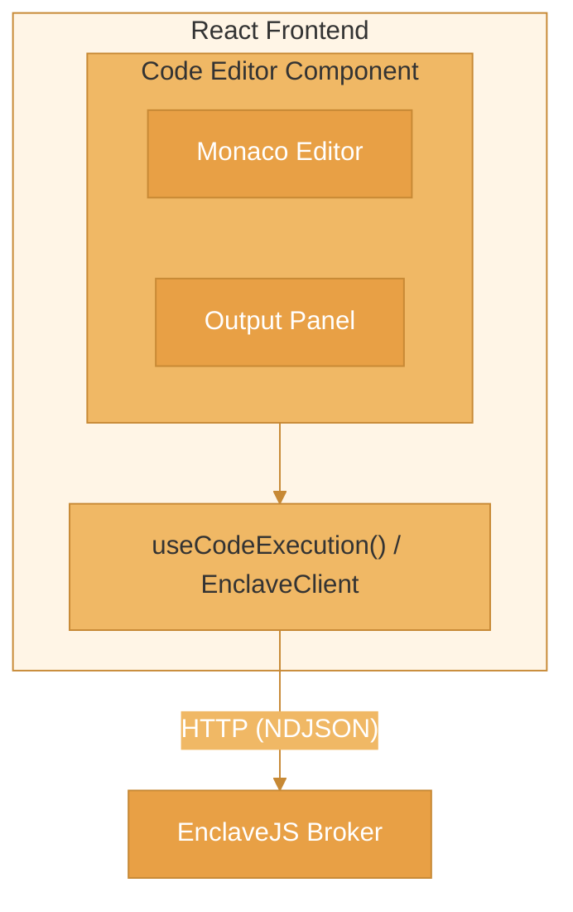

This guide shows how to build a real-time code execution interface using React and the EnclaveJS streaming SDK.

## What You'll Build

A code editor with:
- Real-time syntax highlighting
- Live execution with streaming output
- Tool call visualization
- Error display
- Execution statistics

## Prerequisites

- React 18+
- Node.js server running EnclaveJS broker
- Basic React/TypeScript knowledge

## Project Setup

```bash
npx create-react-app code-editor --template typescript
cd code-editor
npm install @enclave-vm/react @enclave-vm/client @monaco-editor/react
```

## Architecture



## Step 1: Configure EnclaveJS Client

```tsx
// src/enclave/config.ts
import { EnclaveClient } from '@enclave-vm/client';

export const enclaveClient = new EnclaveClient({
  baseUrl: process.env.REACT_APP_ENCLAVE_URL || 'http://localhost:3001',
  autoReconnect: true,
  maxReconnectAttempts: 5,
});
```

The client sends requests and receives events as plain JSON over HTTP: in production use an `https:` base URL, and send your credentials with the `headers` option. The client has no other options than `baseUrl`, `headers`, `timeout`, `autoReconnect`, `maxReconnectAttempts`, `reconnectDelay`, `maxEventLength` and `fetch`; any other option makes the constructor throw.

### An Editor on Another Origin Than the Broker

A browser asks before it sends a request with a JSON body or an `Authorization` header to another origin (the CORS preflight). The broker's session routes answer that question themselves: a page of an origin in the handler's `allowedOrigins` (every origin by default) may send `Content-Type`, `Accept`, `Last-Event-ID` and `Authorization`. A credential in the `Authorization` header therefore works from an editor on another origin. Add it to the client of this step:

```tsx
// src/enclave/config.ts
export const enclaveClient = new EnclaveClient({
  baseUrl: 'https://broker.example.com',
  headers: { Authorization: `Bearer ${token}` }, // your credential, sent with every request of the client
  autoReconnect: true,
  maxReconnectAttempts: 5,
});
```

On the broker, name the origin of the editor, and any other request header your client sends:

```ts
const handler = createSessionHandler({
  broker,
  identify: (request) => (request.raw as { user?: { id: string } }).user?.id,
  allowedOrigins: ['https://app.example.com'],
  allowedHeaders: ['X-API-Key'], // only for a header besides the four above
});
```

A browser does not send a header the preflight answer does not list, so a credential in a header of your own needs its entry in `allowedHeaders`. The preflight is an `OPTIONS` request without the credential: authentication in front of the routes has to let `OPTIONS` requests through to them.

## Step 2: Create the Provider

```tsx
// src/enclave/EnclaveProvider.tsx
import React, { createContext, useContext, ReactNode } from 'react';
import { EnclaveClient } from '@enclave-vm/client';
import { enclaveClient } from './config';

const EnclaveContext = createContext<EnclaveClient | null>(null);

export function EnclaveProvider({ children }: { children: ReactNode }) {
  return (
    <EnclaveContext.Provider value={enclaveClient}>
      {children}
    </EnclaveContext.Provider>
  );
}

export function useEnclaveClient() {
  const client = useContext(EnclaveContext);
  if (!client) {
    throw new Error('useEnclaveClient must be used within EnclaveProvider');
  }
  return client;
}
```

## Step 3: Create Execution Hook

```tsx
// src/hooks/useCodeExecution.ts
import { useState, useCallback, useRef } from 'react';
import { useEnclaveClient } from '../enclave/EnclaveProvider';
import type { SessionHandle } from '@enclave-vm/client';

interface ExecutionState {
  status: 'idle' | 'running' | 'completed' | 'error';
  output: string[];
  toolCalls: ToolCall[];
  result: unknown;
  error: string | null;
  // Set when the broker did not confirm a stop request: that script may still be running
  stopError: string | null;
  stats: ExecutionStats | null;
}

interface ToolCall {
  id: string;
  tool: string;
  args: Record<string, unknown>;
  status: 'pending' | 'completed' | 'error';
}

interface ExecutionStats {
  durationMs: number;
  toolCallCount: number;
}

export function useCodeExecution() {
  const client = useEnclaveClient();
  const sessionRef = useRef<SessionHandle | null>(null);

  const [state, setState] = useState<ExecutionState>({
    status: 'idle',
    output: [],
    toolCalls: [],
    result: null,
    error: null,
    stopError: null,
    stats: null,
  });

  const execute = useCallback(async (code: string) => {
    // Reset state
    setState({
      status: 'running',
      output: [],
      toolCalls: [],
      result: null,
      error: null,
      stopError: null,
      stats: null,
    });

    // executeStream() returns a handle at once; the handlers are called as events arrive
    const session = client.executeStream(code, {
      onStdout: (chunk) => {
        setState(prev => ({ ...prev, output: [...prev.output, chunk] }));
      },
      onToolCall: (callId, toolName, args) => {
        setState(prev => ({
          ...prev,
          toolCalls: [
            ...prev.toolCalls,
            { id: callId, tool: toolName, args: (args ?? {}) as Record<string, unknown>, status: 'pending' },
          ],
        }));
      },
      onToolResultApplied: (callId) => {
        setState(prev => ({
          ...prev,
          toolCalls: prev.toolCalls.map(tc =>
            tc.id === callId ? { ...tc, status: 'completed' } : tc
          ),
        }));
      },
      onError: (code, message) => {
        // cancel() ends the session here before the broker has answered. CANCEL_FAILED means
        // the broker did not confirm the stop: the script may still be running there. The
        // answer can arrive after a newer run has started: it belongs to this run, so it is
        // shown only while this run is still the current one.
        if (code === 'CANCEL_FAILED' && sessionRef.current === session) {
          setState(prev => ({ ...prev, stopError: message }));
        }
      },
    });
    sessionRef.current = session;

    // wait() does not reject: a failed or cancelled session resolves with success: false
    const result = await session.wait();
    if (sessionRef.current !== session) return; // a newer run has started

    if (result.success) {
      setState(prev => ({
        ...prev,
        status: 'completed',
        result: result.value,
        stats: result.stats
          ? { durationMs: result.stats.durationMs, toolCallCount: result.stats.toolCallCount }
          : null,
      }));
    } else if (result.error?.code === 'CANCELLED') {
      setState(prev => ({ ...prev, status: 'idle' }));
    } else {
      setState(prev => ({
        ...prev,
        status: 'error',
        error: result.error?.message ?? 'Execution failed',
      }));
    }
  }, [client]);

  const stop = useCallback(() => {
    // Ends the session in the client at once and asks the broker to end it. cancel() does
    // not reject: a stop the broker did not confirm is reported to onError (see above).
    void sessionRef.current?.cancel('Stopped by the user');
  }, []);

  return {
    ...state,
    execute,
    stop,
    isRunning: state.status === 'running',
  };
}
```

Tools run on the broker. The hook is told about each tool call; it executes nothing. The broker emits no `stdout` events, so `output` stays empty unless your server sends them.

Stopping has two parts. `cancel()` ends the session in the client at once: `wait()` resolves with the code `CANCELLED` and the hook is idle before the broker has answered. The request that asks the broker to end the session can still fail. The client then calls `onError` with the code `CANCEL_FAILED`, and the hook keeps the message in `stopError`: show it, because the script may still be running on the broker. The hook shows it only for the run that is still the current one. When the user has started another run before the answer arrives, the warning would appear on a run that was not stopped, so the hook drops it; an application that has to know about every unconfirmed stop keeps them in a list of its own, by session id.

## Step 4: Build the Editor Component

```tsx
// src/components/CodeEditor.tsx
import React, { useState } from 'react';
import Editor from '@monaco-editor/react';

interface CodeEditorProps {
  value: string;
  onChange: (value: string) => void;
  readOnly?: boolean;
}

export function CodeEditor({ value, onChange, readOnly }: CodeEditorProps) {
  return (
    <Editor
      height="400px"
      language="javascript"
      theme="vs-dark"
      value={value}
      onChange={(v) => onChange(v || '')}
      options={{
        minimap: { enabled: false },
        fontSize: 14,
        lineNumbers: 'on',
        readOnly,
        automaticLayout: true,
      }}
    />
  );
}
```

## Step 5: Build Output Panel

```tsx
// src/components/OutputPanel.tsx
import React from 'react';
import styles from './OutputPanel.module.css';

interface OutputPanelProps {
  output: string[];
  error: string | null;
  result: unknown;
}

export function OutputPanel({ output, error, result }: OutputPanelProps) {
  return (
    <div className={styles.panel}>
      <h3>Output</h3>

      <div className={styles.console}>
        {output.map((line, i) => (
          <div key={i} className={styles.line}>
            {line}
          </div>
        ))}
      </div>

      {error && (
        <div className={styles.error}>
          <strong>Error:</strong> {error}
        </div>
      )}

      {result !== null && (
        <div className={styles.result}>
          <strong>Result:</strong>
          <pre>{JSON.stringify(result, null, 2)}</pre>
        </div>
      )}
    </div>
  );
}
```

## Step 6: Build Tool Calls Panel

```tsx
// src/components/ToolCallsPanel.tsx
import React from 'react';
import styles from './ToolCallsPanel.module.css';

interface ToolCall {
  id: string;
  tool: string;
  args: Record<string, unknown>;
  status: 'pending' | 'completed' | 'error';
}

interface ToolCallsPanelProps {
  toolCalls: ToolCall[];
}

export function ToolCallsPanel({ toolCalls }: ToolCallsPanelProps) {
  if (toolCalls.length === 0) return null;

  return (
    <div className={styles.panel}>
      <h3>Tool Calls</h3>
      <div className={styles.list}>
        {toolCalls.map((call) => (
          <div key={call.id} className={styles.call}>
            <span className={styles.status} data-status={call.status}>
              {call.status === 'pending' ? '...' : call.status === 'completed' ? '✓' : '✗'}
            </span>
            <span className={styles.tool}>{call.tool}</span>
            <span className={styles.args}>
              {JSON.stringify(call.args)}
            </span>
          </div>
        ))}
      </div>
    </div>
  );
}
```

## Step 7: Build Stats Panel

```tsx
// src/components/StatsPanel.tsx
import React from 'react';
import styles from './StatsPanel.module.css';

interface StatsPanelProps {
  stats: {
    durationMs: number;
    toolCallCount: number;
  } | null;
}

export function StatsPanel({ stats }: StatsPanelProps) {
  if (!stats) return null;

  return (
    <div className={styles.panel}>
      <div className={styles.stat}>
        <span className={styles.label}>Duration</span>
        <span className={styles.value}>{stats.durationMs}ms</span>
      </div>
      <div className={styles.stat}>
        <span className={styles.label}>Tool Calls</span>
        <span className={styles.value}>{stats.toolCallCount}</span>
      </div>
    </div>
  );
}
```

## Step 8: Assemble the Main Component

```tsx
// src/components/CodePlayground.tsx
import React, { useState } from 'react';
import { CodeEditor } from './CodeEditor';
import { OutputPanel } from './OutputPanel';
import { ToolCallsPanel } from './ToolCallsPanel';
import { StatsPanel } from './StatsPanel';
import { useCodeExecution } from '../hooks/useCodeExecution';
import styles from './CodePlayground.module.css';

const DEFAULT_CODE = `// List users and filter by name
const users = await callTool('users:list', { limit: 10 });

const filtered = users.filter(u => u.name.startsWith('A'));

return filtered;`;

export function CodePlayground() {
  const [code, setCode] = useState(DEFAULT_CODE);
  const {
    status,
    output,
    toolCalls,
    result,
    error,
    stopError,
    stats,
    execute,
    stop,
    isRunning,
  } = useCodeExecution();

  return (
    <div className={styles.playground}>
      <div className={styles.header}>
        <h1>Code Playground</h1>
        <div className={styles.actions}>
          {isRunning ? (
            <button onClick={stop} className={styles.stopButton}>
              Stop
            </button>
          ) : (
            <button onClick={() => execute(code)} className={styles.runButton}>
              Run
            </button>
          )}
        </div>
      </div>

      <div className={styles.content}>
        <div className={styles.editorPane}>
          <CodeEditor
            value={code}
            onChange={setCode}
            readOnly={isRunning}
          />
        </div>

        <div className={styles.outputPane}>
          <OutputPanel
            output={output}
            error={error}
            result={result}
          />
          <ToolCallsPanel toolCalls={toolCalls} />
          <StatsPanel stats={stats} />
        </div>
      </div>

      <div className={styles.statusBar}>
        Status: {status}
        {stopError && ' (stop not confirmed: the script may still be running on the broker)'}
      </div>
    </div>
  );
}
```

## Step 9: Add Styles

```css
/* src/components/CodePlayground.module.css */
.playground {
  display: flex;
  flex-direction: column;
  height: 100vh;
  background: #1e1e1e;
  color: #fff;
}

.header {
  display: flex;
  justify-content: space-between;
  align-items: center;
  padding: 1rem;
  border-bottom: 1px solid #333;
}

.header h1 {
  margin: 0;
  font-size: 1.25rem;
}

.runButton {
  background: #0e639c;
  color: white;
  border: none;
  padding: 0.5rem 1rem;
  border-radius: 4px;
  cursor: pointer;
}

.runButton:hover {
  background: #1177bb;
}

.stopButton {
  background: #c42b1c;
  color: white;
  border: none;
  padding: 0.5rem 1rem;
  border-radius: 4px;
  cursor: pointer;
}

.content {
  display: flex;
  flex: 1;
  overflow: hidden;
}

.editorPane {
  flex: 1;
  border-right: 1px solid #333;
}

.outputPane {
  flex: 1;
  padding: 1rem;
  overflow-y: auto;
}

.statusBar {
  padding: 0.5rem 1rem;
  background: #007acc;
  font-size: 0.875rem;
}
```

## Step 10: Wire It Up

```tsx
// src/App.tsx
import React from 'react';
import { EnclaveProvider } from './enclave/EnclaveProvider';
import { CodePlayground } from './components/CodePlayground';

function App() {
  return (
    <EnclaveProvider>
      <CodePlayground />
    </EnclaveProvider>
  );
}

export default App;
```

## Using the Official React Package

The `@enclave-vm/react` package provides the provider and the hook ready-made:

```tsx
import { EnclaveProvider, useEnclaveSession } from '@enclave-vm/react';

function App() {
  return (
    <EnclaveProvider config={{ baseUrl: 'https://broker.example.com' }}>
      <MyComponent />
    </EnclaveProvider>
  );
}

function MyComponent() {
  const { execute, cancel, isRunning, result, error, events } = useEnclaveSession({
    onToolCall: (callId, toolName) => console.log('Tool called:', toolName),
  });

  return (
    <div>
      <button onClick={() => execute(code)} disabled={isRunning}>Run</button>
      {isRunning && <button onClick={() => cancel()}>Stop</button>}
      {result?.success && <pre>{JSON.stringify(result.value, null, 2)}</pre>}
      {error && <div>{error.message}</div>}
      <div>{events.length} events</div>
    </div>
  );
}
```

`useEnclaveSession` returns `execute`, `cancel`, `reset`, `state`, `isRunning`, `sessionId`, `result`, `error`, `stdout` and `events`. Its `cancel()` behaves like the one above: the session ends in the client at once, and a stop the broker did not confirm is reported to the hook's `onError` option with the code `CANCEL_FAILED`. See [@enclave-vm/react](/enclavejs/react).

## Best Practices

1. **Debounce execution** - Don't run on every keystroke
2. **Show loading states** - Indicate when code is running
3. **Handle disconnections** - The client reconnects by itself (`autoReconnect`) and resumes after the last event it received
4. **Limit output** - Cap what you keep of the output and the events to prevent memory issues
5. **Sanitize display** - Escape HTML in output
6. **Mobile support** - Handle touch events for mobile editors

## Related

- [@enclave-vm/react](/enclavejs/react) - React SDK reference
- [@enclave-vm/client](/enclavejs/client) - Client SDK reference
- [Streaming UI Example](/examples/streaming-ui) - Complete example
