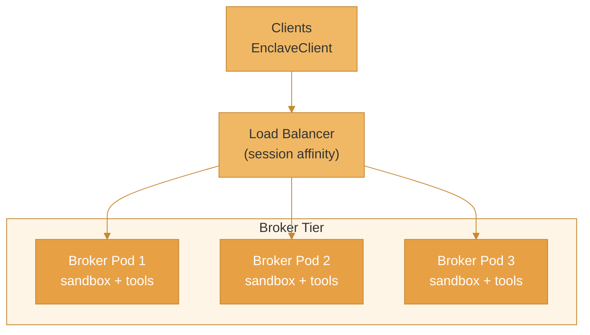

This guide covers scaling Enclave for high-throughput workloads, from single-server optimization to several servers behind a load balancer.

## Scaling Dimensions

| Dimension | Single Server | Several Servers |
|-----------|---------------|-----------------|
| Concurrency | Worker pool | More processes or pods, each with its own enclaves or broker |
| Sessions | In the memory of the broker | In the memory of the broker that created them: route a session's requests to that broker |
| Tool execution | In the host process | In each broker's process |
| State | Process memory | Process memory; the packages have no shared session store |

## Single-Server Scaling

### Worker Pool

By default a script runs on the thread that called `run()`. To run scripts on several threads, use the worker pool adapter:

```ts
import { Enclave } from '@enclave-vm/core';

const enclave = new Enclave({
  adapter: 'worker_threads',
  workerPoolConfig: {
    // Workers kept warm, and the most that run at once
    minWorkers: 2,
    maxWorkers: 4,

    // Heap limit per worker
    memoryLimitPerWorker: 128 * 1024 * 1024, // 128MB

    // Recycle a worker after N executions
    maxExecutionsPerWorker: 1000,

    // Release an idle worker after this long
    idleTimeoutMs: 60000,

    // Executions beyond maxWorkers wait in a queue
    maxQueueSize: 100,
    queueTimeoutMs: 30000,
  },

  toolHandler: async (name, args) => {
    return executeTool(name, args);
  },
});
```

Tool handlers still run on the host thread: a worker sends each tool call to it. Functions in `globals` are not available in a worker. See [Worker Pool](/core-libraries/enclave-vm/worker-pool).

### Pool Sizing Guidelines

| Workload Type | Recommended Pool Size |
|---------------|----------------------|
| CPU-heavy scripts | CPU cores |
| I/O-heavy (tool calls) | CPU cores × 2 |
| Mixed | CPU cores × 1.5 |

```ts
import os from 'os';

const cpuCount = os.cpus().length;
const maxWorkers = Math.max(2, Math.floor(cpuCount * 1.5));
```

Executions beyond `maxWorkers` wait in the pool's queue, and the wait counts against the script's `timeout`. A full queue fails the execution with `QueueFullError`, a wait longer than `queueTimeoutMs` with `QueueTimeoutError`.

### Enclave Pooling

An `Enclave` can be reused for many executions, and with the worker pool one enclave already runs several scripts at a time. To bound the number of in-process executions yourself, keep a pool of enclaves:

```ts
class EnclavePool {
  private pool: Enclave[] = [];
  private available: Set<Enclave> = new Set();
  private waiters: ((enclave: Enclave) => void)[] = [];

  constructor(
    private size: number,
    private config: EnclaveConfig
  ) {
    for (let i = 0; i < size; i++) {
      const enclave = new Enclave(config);
      this.pool.push(enclave);
      this.available.add(enclave);
    }
  }

  async acquire(): Promise<Enclave> {
    // Try to get an available instance
    for (const enclave of this.available) {
      this.available.delete(enclave);
      return enclave;
    }

    // Wait for one to become available
    return new Promise((resolve) => {
      this.waiters.push(resolve);
    });
  }

  release(enclave: Enclave) {
    if (this.waiters.length > 0) {
      const waiter = this.waiters.shift()!;
      waiter(enclave);
    } else {
      this.available.add(enclave);
    }
  }

  async execute(code: string): Promise<ExecutionResult> {
    const enclave = await this.acquire();
    try {
      return await enclave.run(code);
    } finally {
      this.release(enclave);
    }
  }

  dispose() {
    this.pool.forEach(e => e.dispose());
    this.pool = [];
    this.available.clear();
  }
}
```

## Scaling Out

### Architecture

The EnclaveJS broker runs the sandbox in its own process, and a session lives in the memory of the broker that created it. To scale out, run several brokers behind a load balancer:



<Note>
There is no shared session store and no separate runtime tier in the packages. `@enclave-vm/broker` has no Redis or routing options, and `@enclave-vm/runtime` holds building blocks of a runtime worker but does not execute scripts: an `execute` request ends with `RuntimeNotImplementedError`.
</Note>

### Broker Configuration

```ts
// broker/server.ts
import express from 'express';
import { createBroker, createSessionHandler, registerExpressRoutes } from '@enclave-vm/broker';

const broker = createBroker({
  // Options of the sandbox
  enclave: { securityLevel: 'SECURE' },

  // Limits of every session
  limits: {
    maxToolCalls: 50,
    toolTimeoutMs: 10_000, // run time of a script
    sessionTtlMs: 300_000, // 5 minutes
  },

  // The session registry of this broker
  sessions: { maxSessions: 1000 },
});

// broker.tool(...) for each tool

const app = express();
app.use(express.json({ limit: '1mb' }));
app.use(authenticate); // your authentication: the broker has none
registerExpressRoutes(
  app,
  createSessionHandler({
    broker,
    identify: (request) => (request.raw as { user?: { id: string } }).user?.id,
    allowedOrigins: ['https://app.example.com'],
  }),
);

app.listen(3001);
```

When `sessions.maxSessions` sessions are registered, a further `POST /sessions` is answered with `503 MAX_SESSIONS_REACHED`: use that as the backpressure signal.

A session runs on the broker's thread. A script that computes without calling a tool holds that thread, and every other session of that broker, until it ends or reaches `toolTimeoutMs`. Keep the limit low, or give the sandbox the worker pool (`enclave: { adapter: 'worker_threads' }`).

### Client Configuration

```ts
// api/client.ts
import { EnclaveClient } from '@enclave-vm/client';

const client = new EnclaveClient({
  baseUrl: process.env.BROKER_URL!,

  // Credentials for your authentication in front of the broker
  headers: { Authorization: `Bearer ${process.env.BROKER_TOKEN}` },

  // Reconnection
  autoReconnect: true,
  maxReconnectAttempts: 5,
  reconnectDelay: 1000, // grows with each attempt in a row

  // Waiting for the server
  timeout: 60000,
});
```

## Kubernetes Scaling

### Horizontal Pod Autoscaler

```yaml
# hpa.yaml
apiVersion: autoscaling/v2
kind: HorizontalPodAutoscaler
metadata:
  name: enclave-broker-hpa
spec:
  scaleTargetRef:
    apiVersion: apps/v1
    kind: Deployment
    name: enclave-broker
  minReplicas: 2
  maxReplicas: 20
  metrics:
    - type: Resource
      resource:
        name: cpu
        target:
          type: Utilization
          averageUtilization: 70
    - type: Pods
      pods:
        metric:
          name: enclave_active_executions # a metric your application exports
        target:
          type: AverageValue
          averageValue: 10
```

A broker that is scaled down takes its sessions with it: they end for their clients as a lost connection.

### Pod Disruption Budget

```yaml
# pdb.yaml
apiVersion: policy/v1
kind: PodDisruptionBudget
metadata:
  name: enclave-broker-pdb
spec:
  minAvailable: 2
  selector:
    matchLabels:
      app: enclave-broker
```

### Resource Quotas

```yaml
# quota.yaml
apiVersion: v1
kind: ResourceQuota
metadata:
  name: enclave-quota
spec:
  hard:
    requests.cpu: "20"
    requests.memory: 40Gi
    limits.cpu: "40"
    limits.memory: 80Gi
    pods: "50"
```

Give each pod a memory limit. In process the sandbox's `memoryLimit` is an estimate, and a worker's heap limit is a backstop: the container's limit is what bounds a pod.

## Load Balancing

### Sticky Sessions

A session's later requests (a reconnect to `GET /sessions/:sessionId/stream`, a cancel, a status request) have to reach the broker that holds the session. Another broker answers them with `404`. Use session affinity:

```yaml
# ingress.yaml
apiVersion: networking.k8s.io/v1
kind: Ingress
metadata:
  name: enclave-broker
  annotations:
    nginx.ingress.kubernetes.io/affinity: "cookie"
    nginx.ingress.kubernetes.io/session-cookie-name: "enclave-session"
    nginx.ingress.kubernetes.io/session-cookie-max-age: "3600"
```

Cookie affinity works for a client that keeps the cookie and sends it back. Two kinds of client do not:

- A server-side `EnclaveClient` with the default `fetch` keeps no cookies.
- A browser client on another origin than the broker. `EnclaveClient` calls `fetch` without `credentials`, so the browser neither stores nor sends a cookie of another origin, and the broker's routes do not answer with `Access-Control-Allow-Credentials`, which a request with credentials would need.

For a browser, serve the broker under the origin of the page: a path of the application's host that the ingress routes to the brokers. The affinity cookie is then a cookie of the page's own origin, and the browser keeps it. Otherwise use a form of affinity that needs no cookie, such as routing by a header you set in the client's `headers` (for a page on another origin, name that header in the session handler's `allowedHeaders`).

## Performance

Measure with your own scripts and tools: throughput depends on what a script does and on how long its tools take. As a baseline, a small script that makes one tool call costs about 5.9 ms per execution with the double VM on Node.js 24 and 2.7 ms on Node.js 22 (2.9 ms and 1.6 ms with the single VM), measured on arm64. See the runtime notes in the `@enclave-vm/core` README for what the numbers depend on.

## Monitoring at Scale

### Key Metrics

```ts
// Prometheus metrics
const metrics = {
  // Throughput
  executionsPerSecond: new Counter({
    name: 'enclave_executions_per_second',
    help: 'Executions per second',
  }),

  // Latency
  executionLatency: new Histogram({
    name: 'enclave_execution_latency_seconds',
    help: 'Execution latency in seconds',
    buckets: [0.01, 0.05, 0.1, 0.25, 0.5, 1, 2.5, 5, 10],
  }),

  // Queue depth
  queueDepth: new Gauge({
    name: 'enclave_queue_depth',
    help: 'Number of pending executions',
  }),

  // Memory usage
  workerMemory: new Gauge({
    name: 'enclave_worker_memory_bytes',
    help: 'Peak worker memory usage in bytes',
  }),
};
```

These are metrics of your application: the packages export none. With the worker pool, read the counters of the pool (`WorkerPoolAdapter.getMetrics()`: `queuedRequests`, `executingSlots`, `timeoutExecutions`, `memoryKills`, `maxWorkerMemory`, ...) and publish them; see [Monitoring Worker Health](/core-libraries/enclave-vm/worker-pool#monitoring-worker-health).

### Alerting Rules

```yaml
# prometheus-rules.yaml
groups:
  - name: enclave
    rules:
      - alert: HighExecutionLatency
        expr: histogram_quantile(0.99, enclave_execution_latency_seconds) > 5
        for: 5m
        labels:
          severity: warning
        annotations:
          summary: High execution latency detected

      - alert: QueueBacklog
        expr: enclave_queue_depth > 100
        for: 2m
        labels:
          severity: critical
        annotations:
          summary: Execution queue backlog

```

## Best Practices

1. **Start simple** - Use the worker pool before adding servers
2. **Monitor queue depth** - Scale based on pending executions
3. **Set memory limits** - On the sandbox, on the workers and on the container
4. **Use connection pooling** - Reuse the connections your tools need
5. **Implement backpressure** - Reject requests when overloaded (`maxQueueSize`, `sessions.maxSessions`)
6. **Route a session to its broker** - Session affinity for reconnects and cancels
7. **Graceful degradation** - Fallback when components fail

## Related

- [Production Deployment](/guides/production-deployment) - Deployment guide
- [Worker Pool](/core-libraries/enclave-vm/worker-pool) - Worker pool details
- [EnclaveJS Broker](/enclavejs/broker) - Broker configuration
